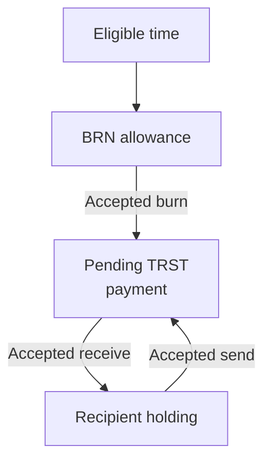
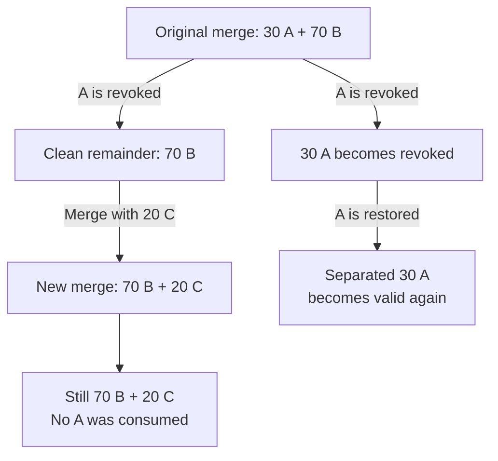

# BRN and TRST

BRN is an allowance computed from eligible time. TRST is transferable currency
created by burning BRN for a payment. Amounts use integer raw units; rates are raw
units per second and timestamps are whole Unix seconds.
One BRN or TRST is 10^18 raw units; one mBRN or mTRST is 10^15 raw units.



Each payment operation is signed and checked by the node. A TRST send spends
existing holdings; it does not mint another payment amount. The next receive
belongs to the new recipient. [Pending receipts](../wallet/PAYMENTS.md) covers rejection
and expiry returns.

## BRN balance

The calculation uses the wallet's verification time, shared rate history and any
intervals during which accrual was paused:

```text
available BRN = accrual during eligible intervals − burned BRN − locked stakes
spendable BRN = available BRN − returned stakes awaiting acknowledgment
```

For example, ten eligible hours at 1 BRN/hour followed by ten at 2 BRN/hour
accrue 30 BRN, not 40. A 500-BRN stake against 600 otherwise spendable BRN leaves
100 available until settlement and any required release acknowledgment.

Rate changes apply to their own time intervals. Resuming accrual does not grant
BRN for a paused interval or recalculate old income at the new rate. Balances are
computed when needed; accrual does not require a periodic transfer to each wallet.

Returned stakes remain unavailable for spending until the account acknowledges
the required outcome evidence in its signed chain. This keeps admission from
depending on which unrelated outcome a node happened to receive first.

See [BRN state](https://github.com/BURST-UBI/protocol/blob/main/brn/src/state.rs), [burn and stake operations](https://github.com/BURST-UBI/protocol/blob/main/brn/src/engine.rs)
and [release accounting](https://github.com/BURST-UBI/protocol/blob/main/brn/src/releases.rs).

## TRST holdings

A holding records its amount, holder, origin and effective origin time. Splits and
transfers preserve provenance. A merge records its immediate inputs in a graph;
later holdings can reference that merge instead of carrying a copy of every
ancestral burn.

A holding ID is not necessarily a ledger-block hash. Change and revocation splits
can create derived IDs. The holding ID identifies the record; its origin and
composition basis describe where the value came from.

A merge must consume distinct holdings owned by the same wallet. It preserves the
sum of their amounts and uses the earliest effective origin time. Live and expired
holdings cannot be mixed in one merge. Expired holdings can be consolidated with
other expired holdings; revoked holdings cannot be merged.

The wallet auto-merge helper sorts active holdings with known remaining lifetimes.
Its default permits at most 10% lifetime loss within a group and 256 inputs per
merge. This is a wallet selection policy; the node still validates every merge.
Combining 40 TRST with ten days remaining and 60 with thirty days remaining would
produce 100 with ten days remaining, so that pair exceeds the default tolerance.

See [auto-merge selection](https://github.com/BURST-UBI/protocol/blob/main/wallet_core/src/auto_merge.rs),
[holdings](https://github.com/BURST-UBI/protocol/blob/main/trst/src/token.rs) and [merge validation](https://github.com/BURST-UBI/protocol/blob/main/trst/src/engine.rs).

## Revocation follows provenance

For a proportional split,
a 100-TRST composition with 40 from a revoked origin allocates 10 revoked and
15 clean to a 25-TRST portion, and 30 revoked and 45 clean to the remaining 75.
Fractional revocations round upward at raw-unit boundaries; this example divides
exactly. More complex histories use
composition records and integer allocation to track affected contributions.
Revocation can affect recipients who did not participate in the original fraud;
it does not reverse an exchange of goods outside the network.

## Merging a clean remainder

A merge origin alone does not describe every later holding. Each holding also has
a **composition basis**: the whole original mixture, one separated origin, or the
remainder recorded after a revocation. This tells the protocol which contributions
that particular holding still contains.

Consider 100 TRST made from 30 from origin A and 70 from origin B:



Restoring A does not insert it into the newer merge. That merge consumed the clean
remainder, whose recorded composition excluded A. If A is revoked again, the newer
merge still has no A contribution to remove. Revoking B can affect it, because it
actually consumed B's value.

These composition records are shared references to revision history. They avoid
copying every excluded origin into each new holding, but checking a remainder can
still require walking that history. See [performance and complexity](../development/PERFORMANCE.md)
for the distinction between indexed lookups and affected-graph traversal.

Re-verifying an originator does not clear an independent outcome invalidation.
Value held under that invalidation stays revoked until its cause is resolved.
Once restoration is allowed, age still determines whether the holding is
spendable. Neither restoration nor merging renews its lifetime.

## Expiry and reference value

Expiry is evaluated using the effective origin time and the current expiry period.
Sending a holding to another wallet does not give it a new lifetime. An active
holding is transferable only while it has not expired.

A longer governed expiry period can make previously expired holdings active
again. A 100-day-old holding is expired under a 90-day period but young enough
under a 120-day period. This does not restore revoked value: legitimacy and age
are separate conditions. Historical ownership and provenance therefore remain
relevant after expiry.

An expired balance is not proof of useful work. The ledger records payments,
not whether goods or services were delivered outside the network.

The age-based reference value falls linearly as expiry approaches. It is separate
from the face amount: a holding halfway through its lifetime has a 50% reference
value, but the protocol does not halve its amount. Neither figure fixes a market
price. Revoked holdings have zero reference value.

## What the parameters mean

The accrual rate controls new BRN eligibility-based income. The expiry period
controls TRST lifetime. A zero accrual rate creates no new BRN, and expiry does not
provide an initial supply. These rules alone establish neither purchasing power
nor an economic equilibrium.
