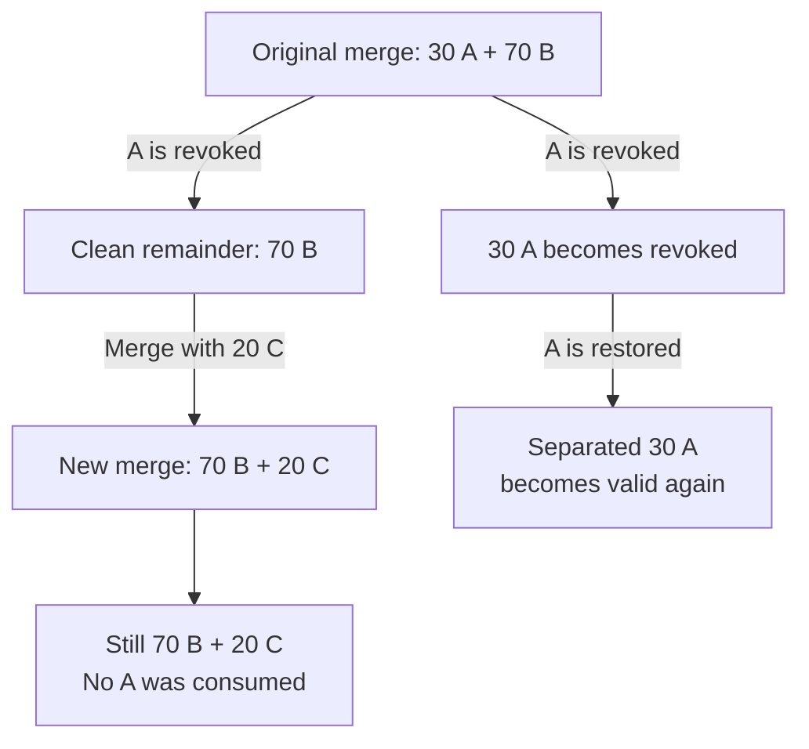

# Balances and units

Your BRN balance answers how much of your personal allowance you can use.
Your TRST balance answers how much transferable money you have received and kept.
The distinction matters when a payment happens: burning 3 BRN reduces the
payer's BRN by 3 and creates 3 TRST for the recipient. It does not give the
recipient 3 BRN.

Suppose Alice earned 5 BRN and uses 3 to pay Bob. She has 2 BRN left from that
allowance. Bob receives 3 TRST, which he can pass on once he meets the spending
requirements. His own BRN is calculated separately.

For this payment, the balances change in two steps:

1. Alice signs a payment of 3 BRN to Bob. Her available BRN falls from 5 to 2.
   The resulting 3 TRST waits for Bob; he cannot spend it yet.
2. Bob signs to accept. Once that receive is confirmed, the 3 TRST is his.
   His own BRN balance has not changed.

Bob can later send that TRST to someone else. That transfer creates no new
TRST; its next recipient must also sign to accept it.

Why keep more information than the total balance? TRST can have an expiry date,
and fraud revocation follows the person whose BRN created it. Two payments of
the same amount can therefore have different histories and risks. This page
starts with BRN, then follows those differences through transfers and merges.
[Sending and receiving](../wallet/PAYMENTS.md) explains pending payments,
rejection and returns.

## BRN balance

The default rate is about one BRN per hour while the account qualifies for
income. The balance grows with eligible time, not with the number of times a
wallet connects or asks for its balance. Spending reduces it; stakes temporarily
lock part of it.

The calculation uses the account's verification time, the income rates that
applied and any periods when income was paused:

```text
available BRN = accrual during eligible intervals − burned BRN − locked stakes
spendable BRN = available BRN − returned stakes awaiting acknowledgment
```

For example, ten eligible hours at 1 BRN/hour followed by ten at 2 BRN/hour
accrue 30 BRN, not 40. A 500-BRN stake against 600 otherwise spendable BRN leaves
100 available until settlement and any required release acknowledgment.

Rate changes apply to their own time intervals. Resuming accrual does not grant
BRN for a paused interval or recalculate old income at the new rate. Balances are
computed when needed; accrual does not require a periodic transfer to each wallet.

Returned stakes remain unavailable for spending until the account acknowledges
the required outcome evidence in its signed chain. This keeps admission from
depending on which unrelated outcome a node happened to receive first.

See [BRN state](https://github.com/BURST-UBI/protocol/blob/main/brn/src/state.rs), [burn and stake operations](https://github.com/BURST-UBI/protocol/blob/main/brn/src/engine.rs)
and [release accounting](https://github.com/BURST-UBI/protocol/blob/main/brn/src/releases.rs).

## TRST holdings

Bob's wallet may show a total TRST balance, but the node keeps records of the
amounts that make it up. A **holding** is one such record: how much TRST it
contains, who owns it, where it came from and how old it is. It is an accounting
record for TRST, not another type of currency.

Splitting a payment or sending it to someone else keeps its origin and age.
The technical name for that recorded history is **provenance**. A merge records
its immediate inputs in a graph;
later holdings can reference that merge instead of carrying a copy of every
ancestral burn.

A holding ID is not necessarily a ledger-block hash. Change and revocation splits
can create derived IDs. The holding ID identifies the record; its origin and
composition basis describe where the value came from.

A merge must consume distinct holdings owned by the same wallet. It preserves the
sum of their amounts and uses the earliest effective origin time. Live and expired
holdings cannot be mixed in one merge. Expired holdings can be consolidated with
other expired holdings; revoked holdings cannot be merged.

The wallet auto-merge helper sorts active holdings with known remaining lifetimes.
Its default permits at most 10% lifetime loss within a group and 256 inputs per
merge. This is a wallet selection policy; the node still validates every merge.
Combining 40 TRST with ten days remaining and 60 with thirty days remaining would
produce 100 with ten days remaining, so that pair exceeds the default tolerance.

See [auto-merge selection](https://github.com/BURST-UBI/protocol/blob/main/wallet_core/src/auto_merge.rs),
[holdings](https://github.com/BURST-UBI/protocol/blob/main/trst/src/token.rs) and [merge validation](https://github.com/BURST-UBI/protocol/blob/main/trst/src/engine.rs).

## How fraud affects later payments {#revocation-follows-provenance}

Suppose Bob combines 40 TRST created by Alice with 60 created by Carol. Later,
a successful fraud challenge invalidates Alice's contribution. Carol's 60 is
not removed with it. The network needs the payment history to distinguish them.

If Bob had already split the combined 100 into portions of 25 and 75, Alice's
40% share would be present in both. The smaller portion contains 10 invalid and
15 unaffected TRST; the larger contains 30 invalid and 45 unaffected TRST.
Fractional revocations round upward at raw-unit boundaries; this example divides
exactly. More complex histories use
composition records and integer allocation to track affected contributions.
Revocation can affect recipients who did not participate in the original fraud;
it does not reverse an exchange of goods outside the network.

## Merging a clean remainder

The next question is what happens when Bob spends or merges the unaffected
money, and the earlier fraud decision is later overturned. Restoring an old
contribution must not silently add it to a new payment that never included it.

Consider a separate example: 100 TRST made from 30 from origin A and 70 from
origin B. Here, an origin is the BRN burn that created that contribution:



Restoring A does not insert it into the newer merge. That merge consumed the clean
remainder, whose recorded composition excluded A. If A is revoked again, the newer
merge still has no A contribution to remove. Revoking B can affect it, because it
actually consumed B's value.

To preserve this distinction, each holding records which version of the mixture
it contains. The code calls this its **composition basis**: the original mixture,
one separated contribution, or the remainder after a revocation.

These composition records are shared references to the history of those changes. They avoid
copying every excluded origin into each new holding, but checking a remainder can
still require walking that history. See [performance and complexity](../development/PERFORMANCE.md)
for the distinction between indexed lookups and affected-graph traversal.

Re-verifying an originator does not clear an independent outcome invalidation.
Value held under that invalidation stays revoked until its cause is resolved.
Once restoration is allowed, age still determines whether the holding is
spendable. Neither restoration nor merging renews its lifetime.

## Expiry and reference value

Expiry is evaluated using the effective origin time and the current expiry period.
Sending a holding to another wallet does not give it a new lifetime. An active
holding is transferable only while it has not expired.

A longer governed expiry period can make previously expired holdings active
again. A 100-day-old holding is expired under a 90-day period but young enough
under a 120-day period. This does not restore revoked value: legitimacy and age
are separate conditions. Historical ownership and provenance therefore remain
relevant after expiry.

An expired balance is not proof of useful work. The ledger records payments,
not whether goods or services were delivered outside the network.

The age-based reference value falls linearly as expiry approaches. It is separate
from the face amount: a holding halfway through its lifetime has a 50% reference
value, but the protocol does not halve its amount. Neither figure fixes a market
price. Revoked holdings have zero reference value.

## Units for wallet developers

The human-readable amounts above use BRN and TRST. The protocol stores amounts
as integers in smaller **raw units** so calculations do not depend on
floating-point rounding. One BRN or TRST is `10^18` raw units; one mBRN or mTRST
is `10^15`. Rates use raw units per second, and timestamps use whole Unix seconds.

For example, 2.5 TRST is `2500000000000000000` raw units. In JavaScript, keep the
RPC string or convert it with `BigInt('2500000000000000000')`. Converting it
through a floating-point `Number` can lose precision.

The default TRST lifetime is `u64::MAX`, which effectively disables expiry.
Finite-lifetime examples describe settings the community can choose. Read the
connected node's `protocol_params` instead of assuming its settings still match
the source defaults.

## What the parameters mean

The accrual rate controls new BRN eligibility-based income. The expiry period
controls TRST lifetime. A zero accrual rate creates no new BRN, and expiry does not
provide an initial supply. These rules alone establish neither purchasing power
nor an economic equilibrium.
