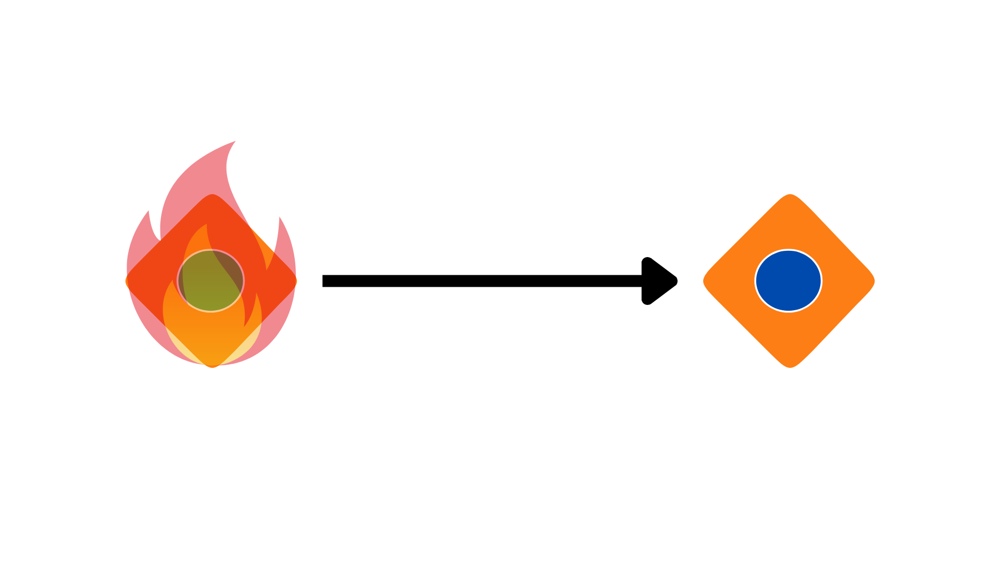

# What is BURST?

BURST is a monetary protocol whose participants choose how quickly personal
income grows and how long money created from that income can be used. These
are its economic *parameters*, decided through voting.

Why build it? Someone with savings can afford to learn, care for a relative
or try an idea. Someone without that cushion may not have the same choice.
An income available to everyone could help, while payments would still let
people earn by doing things others value.

The community can change the income rate, including setting it to zero.
Here is how a payment works with income enabled.

## An income of your own

Once your account is verified, your personal balance grows over time. It is
called **BRN**, from *burn*. At the default rate, an eligible account gains
about <!-- default:live.brn_rate:hourly_approx -->1<!-- /default --> BRN per hour. Unused BRN has no expiry date, so you can save
it until you need it.

Your wallet calculates income from your eligible time, the rates that applied
and what you have spent. Nodes check the same calculation, so nobody needs to
send you an hourly payment.

## Something worth paying for

Suppose Alice has saved 50 BRN. Bob has made something she wants, and they agree
on a price of 50. Alice spends her BRN, which is permanently used up, or burned.
That creates 50 **TRST**, from *trust*, for Bob to accept. The two names together
give BURST its name.

Bob can pay Carol with that TRST, and she can pass it on again. These later
payments move the same money; they do not create more. Both Alice and Bob
continue to gain BRN while they qualify for income.

Unlike saved BRN, circulating TRST has an origin and a history. These let the
network apply an expiry date or trace money created through a false identity.

## Why would someone accept TRST?

Bob accepts because he expects to be able to spend it himself. Its purchasing
power depends on what people will offer for it; the software cannot guarantee
that anyone will accept it.

The default TRST lifetime is <!-- default:live.trst_expiry_secs:years -->70<!-- /default --> years from its effective origin date.
Passing it on does not restart the clock. A year here means 365 days.
(Yes, we know leap years exist.) A limited lifetime gives earlier money a
deadline while new income keeps growing. The community can change that
lifetime, including making it effectively unlimited, but no setting guarantees
stable prices.

## One income for each person

Ten accounts must not mean ten incomes or ten votes. That is why people
need to verify that they are unique.

In ordinary enrollment, verified participants endorse an applicant by burning
some of their own BRN. Verifiers then examine the application. They are chosen
by a random draw from eligible volunteers, using a candidate list agreed before
the random result is known. Everyone can check the draw; the applicant cannot
hand-pick their judges.

A successful fraud challenge removes verified rights and can invalidate TRST
created from that account's BRN, even after it changes hands. Otherwise,
fraudulent income could keep circulating. An honest recipient can lose a
payment for goods already delivered, so these judgments matter.
[Account verification](../protocol/VERIFICATION.md) explains the stakes, appeals
and current restrictions.

## Who checks the payments?

Your wallet signs actions with your account's key. Computers called **nodes**
check those signatures and reject actions that break the rules, such as
overspending.

If someone signs conflicting payments, **representatives** vote on which block
to confirm. Each verified person can assign one equal unit of voting weight to
a representative; holding more money adds no weight. This is separate from
verifiers judging whether an applicant is a unique person. See [consensus](../protocol/CONSENSUS.md).

## Rules people choose together

Participants vote on proposals to change the supported settings. An ordinary
change needs enough participation and support, followed by a wait before it
takes effect. Your payment representative does not automatically get your
governance vote.

A new income rate leaves previously earned BRN intact. A new currency lifetime
can affect money people already hold. [Governance](../protocol/GOVERNANCE.md)
explains how proposals work and what they can change.

## Getting started, then giving up control

A new network needs help forming its first verified community. During bootstrap,
the creator can help verify participants and veto approved rule changes.
Approved proposals proceed unless explicitly vetoed; the creator cannot pass
a change alone. These powers end permanently at <!-- default:live.bootstrap_exit_threshold -->50<!-- /default --> verified people,
including the creator, or sooner if bootstrap ends earlier.
They cannot return if participation later falls. Afterward, the creator follows
the same rules as everyone else. See [bootstrap permissions](../protocol/BOOTSTRAP.md).

Read [balances and units](ECONOMICS.md) for the accounting, or the
[whitepaper](WHITEPAPER.md) for the broader argument. Check
[limits and assumptions](LIMITATIONS.md) before using BURST; some mechanisms
are currently enabled only on experimental networks.
