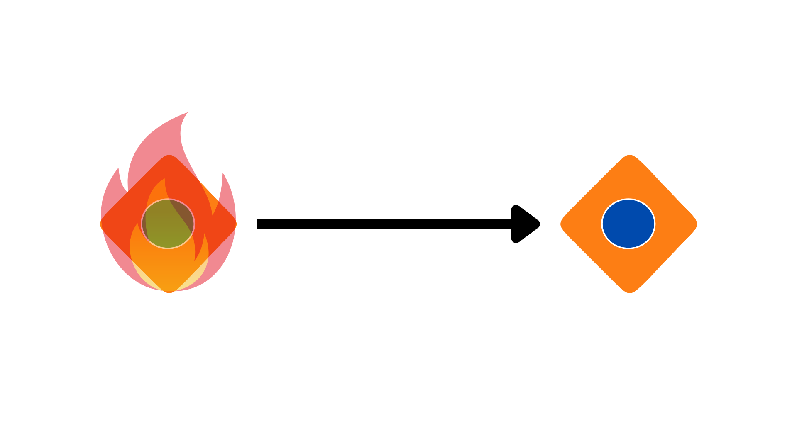
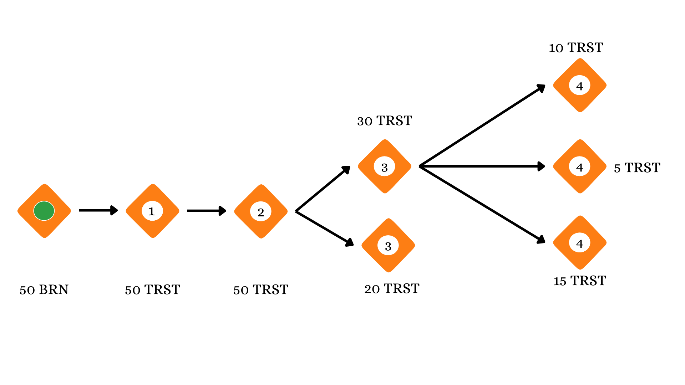
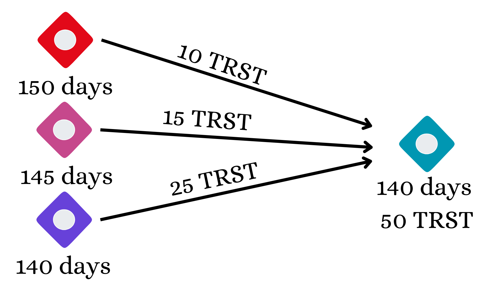
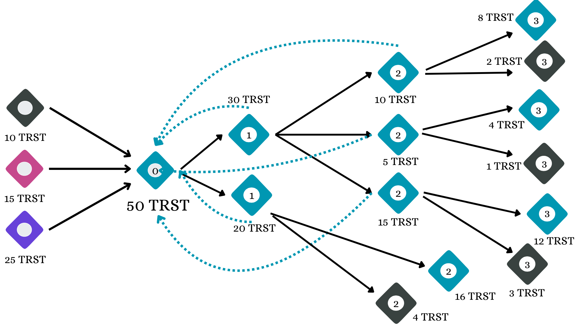

# BURST

BURST is a decentralized, democratic monetary protocol. People receive a personal
income over time, spend it to create transferable currency, and vote on the rules
that govern both.

The name brings together **BRN**, from *burn*, and **TRST**, from *trust*. They have
different jobs. Understanding that distinction is the starting point for everything
else in BURST.

> Everyone should have access to an income. People should also be able to earn
> money by doing things others value.

## An income to start. A reason to contribute. {#why-burst}

Access to money shapes what people can do with their lives. Someone with savings
can take time to learn, care for a relative or try an idea. Someone without them
may have to turn down the same opportunity.

BURST starts from the idea that everyone should have access to an income, and
that people should still be able to earn money by doing things others value.
Its monetary rules give those two purposes separate forms: BRN for personal
income, TRST for payments that can continue circulating.

The people using the system choose its income rate and currency lifetime. These
are parameters of the protocol, so the community can change them through voting.
Universal income is the starting configuration, rather than a rule that the
software's creator can change on everyone's behalf.

## BRN: your personal income

Once your account is verified, BRN accumulates at the same rate as it does for
other eligible accounts. At the current default rate, that is approximately one
BRN per hour. After 50 eligible hours, you would have about 50 BRN, assuming you
had not spent or staked any.

BRN stays with you. You cannot send it to another account. When you use it for a
payment, it is **burned**: the amount is deducted from your allowance and creates
an equal amount of TRST for the recipient.

Unused BRN has no expiry date. You can save the allowance for a later purchase.
The wallet calculates it from your verified time, the income rates that applied
and your spending. The network does not need to send every person an hourly
payment. That matters as participation grows: another hour of income does not
require another transaction from every person.

BRN also pays for certain protocol actions. Endorsements consume it permanently;
stakes lock it while a verification or challenge is being decided. Those amounts
are unavailable for ordinary spending. [Balances and units](ECONOMICS.md) explains
the full calculation.

## TRST: money you can pass on

Suppose Alice has 50 BRN and buys something from Bob for 50. Alice burns her
50 BRN, creating a payment of 50 TRST for Bob. Bob accepts that payment in his
wallet.

Bob now holds 50 TRST. He can use it to pay Carol, who can use it to pay someone
else. Those later payments move the same value; they do not require another burn
and do not create more TRST.

This is why BRN and TRST are separate. Everyone can accrue a personal allowance.
Someone who receives payments can also accumulate and spend transferable money.
The protocol records those payments, while people decide what goods or services
they will exchange for them.

## Why a payment needs two signatures {#sending-and-receiving}

A payment has two sides. The sender signs an operation that creates a pending
payment. The recipient signs an operation to receive it. Until that happens, the
value is pending rather than available for the recipient to spend.

The sender can offer a payment, but cannot write a new block into someone else's
account chain. Receiving is the recipient's signed decision to accept it. That
also gives wallets a place to apply the owner's acceptance rules.

There are two ways to pay:

| You spend | The recipient receives | New TRST created? |
| --- | --- | --- |
| 50 BRN | 50 TRST | Yes, from the burn. |
| 50 TRST | 50 TRST | No, existing TRST changes hands. |

A recipient can reject a payment. That creates a return receipt for the sender
to accept. It returns TRST; it does not recreate the BRN used in the original burn.

Receiving TRST and becoming verified are separate. An unverified account can
receive a payment, but must gain verified rights before ordinary spending.
Applications must also distinguish submitting a signed payment from the network
confirming it. The [payment guide](../wallet/PAYMENTS.md) covers those steps.

## Spend a little. Keep the rest. {#splitting-trst}

Bob does not have to spend his 50 TRST all at once. He can send 30 and keep 20.
The recipient of the 30 can later divide it into payments of 10, 5 and 15.

The amounts still add up to 50. Each part keeps a record of where it came from,
so the network can connect it to the original BRN burn. The numbers inside the
shapes show successive steps in this example, not separate new currency issues.

That history matters for two things: how old the TRST is, and what happens if
its original creator is later found to have obtained verification fraudulently.

## Should money have a lifetime? {#expiry}

A continuing personal income creates new spending power. A finite lifetime gives
the community a way to limit how long previously issued TRST remains in
circulation. It is an economic choice with a real cost: holders must consider
how much time remains when they accept a payment.

The community can give TRST a finite lifetime. For example, with a 30-year
lifetime, TRST becomes unspendable 30 years after its creation, whoever holds it
then. Passing it to another account does not restart its age.

The current defaults use an effectively unlimited lifetime. The finite lifetimes
in these examples illustrate a setting the community can choose.

Expiry applies to TRST, not unused BRN. A person can keep their personal allowance
until they need it; the currency created when they spend that allowance can have
a limited period of circulation.

The amount does not gradually shrink. A holding of 50 TRST remains 50 TRST until
expiry makes it unspendable. Wallets can show an age-based reference value, but
people still choose the price at which they will accept it.

An expired holding remains recorded. If the governed lifetime later increases,
its age may fall within the new limit and it can become spendable again. Fraud
revocation is a separate condition, explained below.

## Combine payments without erasing their past {#merging-trst}

A wallet can receive many small holdings. Merging combines compatible holdings
into one larger amount so they are easier to use together.

The merged amount is the sum of its inputs. Its expiry is the earliest expiry
among them. Otherwise, someone could keep old currency alive by repeatedly
mixing it with newer currency.

> A merge combines value. It does not renew it.

Here, 10 + 15 + 25 becomes 50 TRST, with 140 days remaining. Grouping holdings with
similar lifetimes avoids sacrificing much of the newer inputs' remaining time.
The wallet can make that selection automatically.

Merging also keeps the history of the inputs. Nodes store a **merger graph**:
each merge points to the holdings it consumed. Another merge can refer to that
result without copying the whole history into every payment.

The current operation accepts up to 256 inputs. Active and expired holdings cannot
be mixed, and revoked value cannot be merged. Those rules keep consolidation
from making unusable value spendable.

## What happens when an identity was false? {#revocation-and-restoration}

What if the creator of some TRST passed verification using a false identity?
If simply losing verified status left all earlier issuance intact, a false
identity could still leave its income circulating. BURST therefore connects
issued value to its origin. Once a fraud challenge succeeds, the protocol revokes the value originating from
that account. Its history lets nodes find the affected contributions even after
they have been transferred, split or merged.

Consider the same 50-TRST merge. If its 10-TRST input came from the fraudulent
account, one fifth of the mixture is affected. A later 10-TRST portion contains
2 affected TRST and 8 unaffected TRST. A 20-TRST portion contains 4 affected and
16 unaffected.

The dark portions show the revoked value. The other contributions remain usable,
subject to their age. The network records the separation so a later payment or
merge uses the value the holder actually has left.

If the origin is restored after re-verification, its separated value can become
valid again. It does not get inserted into a newer merge that consumed only the
unaffected remainder. [This worked example](ECONOMICS.md#merging-a-clean-remainder)
shows that case in detail.

Revocation can therefore affect an honest recipient. It cannot recover goods
already delivered to a fraudulent payer. Knowing the origin of a payment helps
people assess that risk; it does not remove it.

## One person, one income {#humanity-verification}

Equal income and equal voting weight depend on people being unable to enroll
unlimited identities. BURST uses endorsements and selected verifier panels to
make that judgment. Creating a new key is cheap; establishing another
verified person must require more than creating another wallet.

An applicant receives endorsements from verified accounts. Endorsers burn BRN to
support the application. Once the requirement is met, the network selects a panel
from eligible people who have volunteered to verify others.

The panel examines evidence and votes **Legitimate**, **Illegitimate** or
**Neither**. Substantive votes require a stake. Neither needs no stake and does
not count toward acceptance. Missing votes become Neither at the deadline.
The protocol defines how much support is needed, whether another panel is tried,
and how stakes are returned or forfeited.

For example, the default panel has seven members and requires 90% Legitimate
votes. Six out of seven is only about 85.7%, so all seven must support acceptance
in that case. These requirements are governable parameters.

Panel selection must be reproducible. Nodes agree on the eligible pool before
using a designated future randomness result from drand. Every node then uses the
same inputs to select the same panel. Using a future result means an applicant
cannot simply choose a panel of friends; fixing the pool first prevents nodes
from changing the candidate list after seeing the randomness.

People assess the evidence; software records and applies their votes. The
protocol does not supply an automatic biometric or identity-document check.
The [verification guide](../protocol/VERIFICATION.md) covers selection requirements,
voting, stakes and deadlines.

### Challenges and appeals

Verification has no scheduled renewal date. Another eligible participant can
challenge an account under the protocol's rules, putting up the required stake.
Submitting a challenge starts a review; it does not immediately revoke the target.

A successful fraud challenge removes verified rights and revokes the account's
TRST origins. An inactivity outcome deactivates the account without revoking
its earlier TRST. Both stop new BRN accrual while the account is inactive.

Re-verification can restore eligibility without awarding income for the inactive
period. An appeal reviews an earlier challenge judgment. These processes can
correct decisions, but still depend on the people judging them.

### Optional trust policies

A recipient can choose stricter automatic acceptance rules in their wallet.
They may trust particular original creators, or require those creators to belong
to selected groups. Groups provide membership services outside the protocol.

If Bob sends Alice's TRST to Carol, a creator policy checks Alice. A sender
allow-list checks Bob. These answer different questions. Neither changes the
network's rules; a payment held for review can still be received manually.
See [acceptance policies](../wallet/TRUST.md).

## How the network agrees {#agreement-between-nodes}

A wallet holds the account's keys and signs its actions. Nodes check those actions
and maintain the ledger. Each account has its own chain of blocks, and a receive
connects its chain to the payment it claims.

If two blocks try to follow the same predecessor, representatives vote on which
one to confirm. Each verified account gives one equal unit of weight to its
chosen representative. Holding more BRN or TRST adds no voting weight.

> The unit of voting weight is a verified person, not a unit of money.

Some decisions affect many accounts at once: a verification result, a change to
the income rate, or the set of representatives. Nodes use **checkpoints** to agree
on the account history and shared state at those boundaries. They check the
representatives' signatures and calculate the resulting state from the agreed
history.

Representatives need enough voting weight online to make progress. Their saved
signing history also matters: restarting a node must not let it sign a conflicting
promise. [Consensus](../protocol/CONSENSUS.md) and
[checkpoints](../protocol/CHECKPOINTS.md) explain these mechanisms.

## Time and deadlines

Time determines BRN accrual and, where enabled, TRST expiry. It also sets the
windows for voting and selection. Nodes use clock estimates for local checks and
agreed checkpoints for shared deadline effects.

Representative checkpoint signing uses authenticated external time sources.
Random panel selection uses a separately verified drand result. If the required
time or randomness is unavailable, the affected work waits; the node cannot
invent a replacement result. See [node time configuration](../node/NODES.md#time-and-agreed-transitions).

## Who gets to change the rules? {#governance}

The community chooses the income rate and currency lifetime through verified-account
voting. The same process governs supported verification and governance settings.
A representative chosen to confirm payments does not automatically receive your
governance vote.

An ordinary proposal gathers endorsements, enters voting, and must meet both
participation and approval thresholds. Abstaining counts toward participation
without supporting approval. An approved change waits through a cooldown before
activation. The cooldown separates approving a rule from putting it into effect,
giving participants time to see what will change. Emergency proposals use a shorter path with higher voting requirements.

A rate change affects income from that point onward. Previously earned BRN keeps
the rates that applied when it accrued. A lifetime change changes how old TRST
may be while remaining spendable.

The protocol also supports constitutional text and scoped voting delegation.
Constitutional text records the community's rules; executable changes still
require software that implements them. [Governance](../protocol/GOVERNANCE.md)
and the [parameter reference](../protocol/PARAMETERS.md) describe the supported changes.

### The first participants

A new network begins without enough ordinary verifiers. During bootstrap, the
creator can endorse people through a special verification path. These
endorsements still consume BRN.

The creator can also veto an approved governance proposal before it activates.
Otherwise, activation needs no separate creator approval. These special powers
end permanently at the bootstrap threshold, capped at 50 verified accounts
including the creator. A later fall in population does not bring them back.
See [bootstrap permissions](../protocol/BOOTSTRAP.md).

## Economic choices

The two central parameters make different choices possible. A positive income
rate supplies personal spending allowances. A finite TRST lifetime limits how
long issued currency circulates. An unlimited lifetime lets it remain
transferable regardless of age. A zero income rate stops new accrual.

These settings affect issuance and circulation. Prices still depend on what
people offer and accept. Unspent BRN also matters: people can turn accumulated
allowances into new TRST later, so the current income rate alone does not determine
how much TRST enters circulation today.

BURST makes these choices part of the community's monetary rules. Whether those
rules produce a useful economy depends on participation, reliable verification,
goods and services, and decisions made through governance.

## Wallets, nodes and history

A recovery phrase restores an account's key. The wallet reads its balances and
verification state from the network. Saved signed actions need separate recovery
handling if their outcome is uncertain; a lost response does not mean a payment
failed.

Nodes retain the state needed to check payments, including holdings, pending
receipts and merge history. Expired value can still matter for restoration or a
future lifetime change. An authenticated snapshot can help recover state, but
keeping only the latest block of each account is insufficient.

The ledger is public. Addresses do not contain people's names, but activity and
external information can connect an address to a person. See
[wallet recovery](../wallet/WALLETS.md), [node storage](../node/NODES.md) and
[privacy](../release/PRIVACY.md).

## Cryptography and upgrades

Accounts use Ed25519 signatures. Hashing and proof of work use Blake2b.
Proof of work supplies an anti-spam computation cost; it does not mine currency
or give the worker voting weight.

Changing these algorithms or introducing new executable rules requires a software
upgrade. Parameter votes and epoch markers do not install code. The
[cryptography reference](../development/CRYPTOGRAPHY.md) documents the formats.

## Implementation status

The current source enables certified verifier selection, governance and appeals
only on experimental Dev/Test builds. They are not currently enabled on Live.
Physical deletion of historical block bodies is also release-gated. The
[availability table](LIMITATIONS.md#feature-availability) records these restrictions.

The accounting can be checked in code and tests. Verification quality, resistance
to collusion and the behavior of a real economy also need observation and
independent review. The [limitations](LIMITATIONS.md) explain those assumptions.

For implementation work, start with [accounts and blocks](../protocol/BLOCKS.md),
[RPC](../development/RPC.md), or [build and test](../development/DEVELOPING.md).
The [architecture guide](../development/ARCHITECTURE.md) maps those mechanisms to code.
