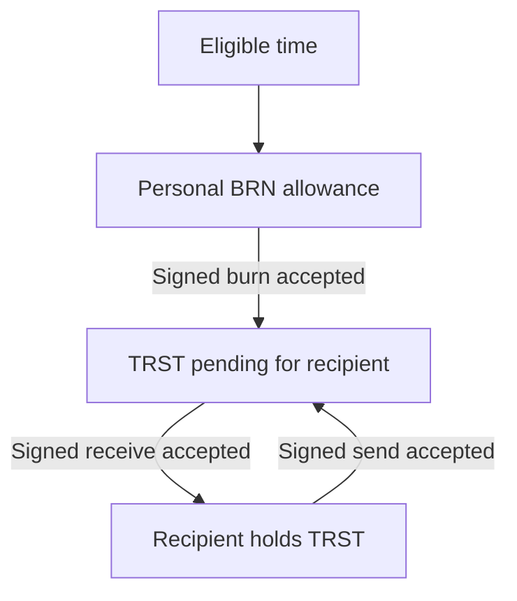
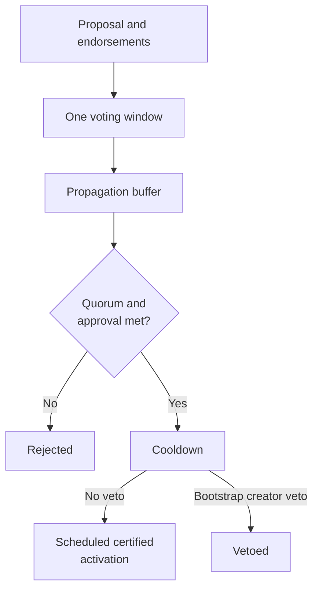

# BURST

This document explains the protocol implemented in the repository. Some paths,
including certified verifier selection and governance, are currently restricted
to experimental Dev/Test builds. See [feature availability](LIMITATIONS.md#feature-availability)
before treating a mechanism described here as a Live-network feature.

## Purpose

BURST explores a monetary system in which verified people accrue an equal spending
allowance over time. Spending that allowance creates transferable currency for a
recipient. The community governs the accrual rate and how long the transferable
currency remains usable.

The aim is to make access to income part of the monetary rules. The protocol can
account for balances and enforce accepted transactions; it cannot guarantee what
those balances will buy. Adoption, prices, available goods and the quality of
human verification still matter.

## Two forms of value

**BRN** is a computed allowance. It accrues while a wallet is eligible, according
to the rate history. A person cannot transfer BRN to another wallet. They can burn
it for a payment or commit it to protocol operations such as staking.

**TRST** is transferable currency created by burning BRN. A payment burn creates
TRST at a one-to-one raw-unit ratio. TRST can then change hands without another BRN
burn. Its provenance records which burns contributed to it, including after
splits and merges.

For example, suppose an eligible wallet accrues 10 BRN and burns 3 BRN to pay a
shop. The payment creates 3 TRST for the shop to receive. The payer has 7 BRN left,
assuming no stakes or other burns. The shop can pay someone else with its TRST.
The numbers illustrate the accounting; they are not prices or protocol defaults.

The loop transfers existing TRST. Only the burn creates new TRST in this payment
flow. Burning spends the allowance; it does not place BRN in a reserve that the
recipient can redeem.

## What the community controls

The BRN rate sets how much eligible wallets accrue per second. Historical rate
changes remain part of the calculation. Setting the rate to zero stops new
accrual; it does not create an initial currency supply or erase existing holdings.

The TRST expiry period determines how long a holding remains transferable from its
effective origin time. A transfer does not restart that clock. Merging holdings
uses the oldest input's effective origin time, so merging cannot extend their
lifetime.

The default parameter set enables accrual at approximately one BRN per hour and
uses `u64::MAX` for TRST lifetime, effectively disabling expiry. The code does not
launch with zero accrual. See [protocol parameters](../protocol/PARAMETERS.md) for exact raw
values and enforcement.

| Configuration | Accounting effect |
| --- | --- |
| Positive accrual, no effective expiry | Eligible wallets accumulate BRN; age does not remove TRST from transferability. |
| Positive accrual, finite expiry | BRN accrues while TRST is subject to an age limit. |
| Zero accrual | Time creates no further BRN; existing balances and other protocol rules remain. |

Changing these settings does not establish an initial currency supply, merchant
acceptance or a particular political system. A later vote can change a parameter
again, but cannot undo the consequences of transactions made under the earlier rule.

These parameters offer choices about issuance and expiry. They do not describe
every economic system: credit, ownership, taxation, market access and other rules
are separate questions.

## Verification and accountability

Humanity verification determines eligibility. Endorsements, verifier decisions,
challenges and appeals provide ways to admit people and contest mistakes or abuse.
They are mechanisms for making and revisiting judgments, not proof that duplicate
or fraudulent identities are impossible.

Provenance lets the protocol identify currency affected by an origin's revocation,
even after that currency has moved. This also means a recipient can hold value
whose validity depends on a later judgment about its origin. That consequence is
part of the design and should be understood before accepting payments.

## Balances and payments

BRN is calculated from eligible time at the rates that applied during each
interval. Burned amounts and locked stakes reduce the available balance. Returned
stakes awaiting a signed acknowledgment are also excluded from spendable BRN.
Pausing and later resuming eligibility does not award income for the pause.

A BRN payment burns an amount and creates an equal TRST amount for a recipient.
A TRST payment spends existing holdings. Both create a pending transfer that the
recipient claims with a signed receive operation. The sender's operation alone is
not a completed receipt. Opening a new account can also claim a pending transfer.
The recipient can instead sign a rejection, returning TRST through another pending
receipt for the sender to claim. This does not reverse the original BRN burn.
See [payments and returns](../wallet/PAYMENTS.md).

Operations are signed account-chain blocks. Each block identifies its account,
predecessor, operation, balances, timestamp and relevant dependencies. It also
binds the payment epoch and signing grant. The meaning of some fields depends on
the operation: a payment's destination and a receive's source block, for example,
use the same `link` field. The [block definition](https://github.com/BURST-UBI/protocol/blob/main/ledger/src/state_block.rs) is the
format reference; the [payment transition](https://github.com/BURST-UBI/protocol/blob/main/node/src/payment_transition.rs) owns
validation and persistence.

The [BRN and TRST guide](ECONOMICS.md) explains balance calculations and the
difference between face amounts, transferable holdings and reference values.

## Splitting and merging

Spending part of a holding preserves the provenance of both the spent amount and
the remainder. Splitting does not create value or restart the expiry clock.
Derived holding identifiers need not be hashes of separate on-chain blocks.

A merge combines distinct holdings owned by one wallet. Its amount is their sum,
and its effective origin time is the oldest of its inputs. This can shorten the
useful lifetime of newer inputs, so input selection matters. Live and expired
holdings cannot be mixed; expired holdings can be consolidated together.

The wallet can select the inputs explicitly. A merge block with an empty input
list requests the node's deterministic expiry-grouped selection. Either way, the
node validates the merge. Wallet automation does not give the wallet authority to
change the accounting rules.

A merged holding refers to the merge's hash. The merger graph stores its immediate
sources and their contributions. A later merge can reference that result without
copying every ancestral burn into the new holding.

A holding's **composition basis** identifies the original mixture, a separated
origin, or a recorded remainder after revocation. If a 30/70 mixture loses the
30-unit contribution, a later merge can consume only the clean 70. Restoring the
separated 30 does not add it to that later merge. Its inputs remain the ones it
actually consumed. See the [worked composition example](ECONOMICS.md#merging-a-clean-remainder).

## Expiry

TRST becomes non-transferable when its age reaches the governed expiry period.
The comparison uses the effective origin time; transferring or merging cannot
renew it. Expiry and revocation are separate conditions.

An expired holding can remain in the recorded state without contributing to
spendable currency. That record does not by itself prove useful work: a payment
records a transfer, not what happened outside the network. Historical data
availability also depends on node storage and retention rules.

The software computes a linear age-based reference value. It does not continuously
reduce the holding's face amount or prescribe its market price. People may value
holdings differently because of expiry, provenance or their willingness to accept
BURST at all.

## Revocation and restoration

When an accepted fraud outcome revokes an origin, provenance identifies affected
holdings, including value that has passed through merges. Affected contributions
are separated from clean value. Integer allocation and composition records keep
later transfers and restoration consistent with those splits.

The [merger graph](https://github.com/BURST-UBI/protocol/blob/main/trst/src/merger_graph.rs) indexes downstream relationships. A
revocation visits affected merges and records the revoked contributions; restoration
removes their revocation markings when the corresponding origin is restored. The
[TRST engine](https://github.com/BURST-UBI/protocol/blob/main/trst/src/engine.rs) applies the resulting holding changes.
Restoration does not renew age: a restored amount can still be expired under the
current lifetime. Independent invalidation reasons can keep an origin revoked.

This avoids repeatedly expanding every ancestral burn for ordinary operations.
It does not make all work constant-time. Revocation and restoration depend on the
affected graph and holdings, while storage lookups and payment preparation have
their own costs.

Deactivation is different from fraud revocation. It stops BRN accrual without
revoking previously originated TRST. The distinction matters to recipients, who
should not treat every loss of verification as invalidation of existing currency.

## Humanity verification

Verification aims to give each person one eligible account. The protocol records
endorsements and judgments; it does not directly establish a person's identity.
The quality of those judgments depends on the evidence and the people assessing it.

### Endorsement and panel votes

Ordinary enrollment starts with endorsements. Endorsers burn BRN to vouch for the
target. This burn is permanent, and endorsers receive no protocol reward for a
successful verification.

Once the endorsement requirement is met, a verifier panel is selected from the
eligible pool. Verifiers must opt in and meet the selection rules; being verified
alone does not put every person on duty. See [eligibility](../protocol/VERIFICATION.md#ordinary-enrollment).
Certified selection fixes the relevant state and randomness so
nodes can agree on the panel. A node cannot substitute whichever verifiers happen
to be available in its current local state.

Selected verifiers vote Legitimate, Illegitimate or Neither. The acceptance
threshold is governed. Neither does not support acceptance and requires no vote
stake or reward; absent votes default to Neither at the applicable deadline.
Repeated Neither votes can trigger a governed penalty based on a rolling
assignment window. They are not simply ignored votes.

A failed round can lead to another panel while revotes remain. The protocol
settles stakes against the accepted outcome: dissenting stakes are forfeited,
and eligible staked voters on the winning side share the forfeited pool as TRST.
If there are no forfeited stakes, there is no reward pool. Agreement with an
outcome is an accounting condition, not proof that the judgment was correct.

See [vote counting](https://github.com/BURST-UBI/protocol/blob/main/verification/src/voting.rs),
[selection and lifecycle](https://github.com/BURST-UBI/protocol/blob/main/verification/src/orchestrator.rs) and
[settlement](https://github.com/BURST-UBI/protocol/blob/main/verification/src/outcomes.rs).

### Eligibility over time

Verified status has no recurring renewal date. An unresolved challenge retains
verified rights until its outcome is applied. Revocation or deactivation stops
accrual and removes verified spending rights, while preserving the BRN accounting
history. It does not erase previously earned allowance or credit the inactive
period later.

Re-verification requires a fresh enrollment attempt after any active challenge
settles. A successful outcome resumes accrual; it does not create a new account
or erase the old account's transactions.

### Challenges and appeals

A challenge asks the network to review an existing account. It requires an
admissible signed operation and BRN stake; eligibility, deadlines and an existing
case can restrict admission. It is not an unrestricted instruction to revoke
someone's funds.

Fraud and inactivity have different consequences. A fraud outcome can revoke
currency originating from the account. Deactivation stops accrual without that
revocation. An appeal refers to an earlier judgment; its result must be compared
with that judgment before applying a reversal.

These mechanisms do not undo exchanges of goods or compensate every affected
recipient. Revocation changes ledger validity. It cannot recover things delivered
outside the network, and a mistaken judgment can itself cause harm.

Certified verification and appeal admission have explicit network and build gates.
A mechanism described here may be unavailable in a particular release. The
[verification policy](https://github.com/BURST-UBI/protocol/blob/main/verification/src/lib.rs) and
[node release policy](https://github.com/BURST-UBI/protocol/blob/main/node/src/release_policy.rs) define those boundaries.

### Evidence and optional group trust

People may use different evidence when assessing uniqueness. The repository has
a `VerificationMethod` interface, but it does not ship biometric or government-ID
adapters merely because that interface exists. Such integrations need their own
implementation, privacy choices and assessment of fraud risks. Changing an
assessment method does not bypass signed panel votes or the agreed settlement
rules.

Group trust is an optional wallet policy. A receiver chooses trusted groups and
can query their membership services about payment origins. This supplements the
protocol's judgment; a group response cannot change consensus validity or make
revoked currency spendable. See [group membership and payment policies](../wallet/TRUST.md#group-trust).

### The first participants

Bootstrap permits a creator verification path before there is a sufficient
ordinary verifier population. Special authority ends at the governed threshold,
capped at 50 verified accounts including the creator, and cannot revive merely
because the count later falls. During bootstrap the creator may veto an approved
governance proposal before activation; activation requires no separate creator
approval. See [bootstrap authority](../protocol/BOOTSTRAP.md).

### Security assumptions

Endorsement costs, random panel selection and challenges impose costs and provide
ways to contest fraud. They do not prove that collusion is unprofitable or establish
a safe percentage of fraudulent accounts. Those claims require analysis beyond
the accounting rules. Users also face the risk of incorrect decisions and
provenance-dependent payment acceptance.

If fraudulent identities control the electorate, ordinary voting cannot be
assumed to repair it. Individual challenges are not an automatic reset for a
compromised majority. Recovery through a fork would require agreement outside
that decision process about which state and identities to trust.

## Agreement between nodes

Accounts have separate signed chains. A payment links a sender's operation to a
recipient's receive operation. Representatives vote to resolve competing account
blocks; shared protocol decisions also use certified checkpoints. Separate account
chains therefore do not mean that every operation is independent of shared state.

Each verified account contributes one equal unit to its chosen representative.
BRN, TRST, expired holdings and creator status add no weight. This accounting
assumes that verification identifies distinct people; consensus cannot establish
human uniqueness on its own.

A node validates signatures, account-chain continuity and the rules for each
operation before applying it. Proof of work and bounded queues limit resource
use. They impose computation and capacity limits, not a transaction fee paid to a
miner. Confirmation time and hardware requirements depend on workload, network
conditions and representative availability; the protocol does not guarantee
sub-second service or constant cost for every operation.

## Time and deadlines

The node uses time for BRN accrual, admission windows, expiry and voting deadlines.
A synchronized wall clock supplies an estimate; it does not prove that other
nodes have accepted a transition. Agreed checkpoint boundaries coordinate shared
deadline effects, while admission applies its timestamp rules. One node reaching
a deadline cannot independently settle the network's state.

Clock failure, drift and unavailable time sources are operational concerns even
when signatures are valid. See [time and agreed transitions](../node/NODES.md#time-and-agreed-transitions)
and [network dependencies](../release/PRIVACY.md) for the separation between clock services,
beacon services and protocol agreement.

## Randomness and verifier selection

Verifier selection needs agreement on both the eligible pool and the randomness
used to sample it. An accepted selection checkpoint fixes the request, pool and
beacon round. The node retrieves that exact drand output. If the relay is
unavailable, the request stays pending: a node cannot substitute another round or
choose a new pool locally.

Drand supplies verifiable randomness; it does not decide which accounts are
eligible or replace BURST's agreement on the selection inputs. Availability and
security depend on both systems. Replacing drand with an internal beacon would
require a separate protocol and security analysis, rather than simply removing a
network dependency.

A commit-reveal design must address withholding: waiting for every reveal can
stall, while excluding missing reveals may let participants influence the output.
The repository's experimental helper does not solve distributed membership or
recovery. A BURST-operated threshold beacon would also need key generation,
committee rotation and failure recovery under stated corruption assumptions.
These are possible research directions, not scheduled or completed replacements.
See [experimental randomness](../protocol/CONSENSUS.md#experimental-randomness-helper).

## Governance

Governance changes the supported protocol parameters through verified-account
voting. It does not install arbitrary code. New executable rules still require a
software release. Parameter values must fit the implementation's supported types
and validation rules.

An ordinary proposal follows this lifecycle:

Endorsements burn BRN and qualify a proposal for voting. Votes can be **yea**,
**nay** or **abstain**. Quorum measures participation against the eligible
population; abstentions count as participation. Approval measures yea votes
against yea plus nay votes. Both thresholds must pass. A failed vote is final;
trying again requires a new proposal and endorsements.

The propagation buffer separates the close of voting from counting. Successful
ordinary proposals enter cooldown, then activate through the certified protocol
path at their scheduled time. There is no second ballot. Emergency parameter
proposals skip the endorsement and cooldown stages and use their applicable
emergency thresholds.

During bootstrap, the creator may explicitly veto an approved proposal before
activation. Otherwise activation needs no creator approval. This authority ends
permanently at the [bootstrap threshold](../protocol/BOOTSTRAP.md).

### Constitution and delegation

The governance code also models constitutional articles and amendments,
representative eviction and reinstatement, and delegated governance ballots.
Constitutional text records community rules; software cannot automatically resolve
all disputes about its meaning. Constitutional proposals have their own quorum
and approval thresholds.

These code paths must be distinguished from available network features. Full
governance-content operations and ledger-backed governance delegation are currently disabled
on the live network. Their experimental switch applies only to development and
test networks. Selecting a representative for transaction consensus is separate
from delegating a governance ballot.

A later proposal can change a parameter again, but this does not undo transactions
or real-world decisions made under its previous value.

## Wallets, nodes and history

Wallets manage keys, explain the operation being signed, and submit signed
operations to nodes. Nodes validate and persist ledger state, exchange data with
peers and participate in the protocol according to their configuration. Running a
node does not grant extra voting weight.

A wallet can receive TRST before verification, but receipt does not grant accrual
or ordinary spending rights. It should distinguish BRN allowance, transferable
TRST, expired value and revoked value rather than combine them into one spendable
balance. Delegated voting keys have restricted authority; they are not substitutes
for account spending keys. See [wallets and signing](../wallet/WALLETS.md).

Families or organizations may arrange custody, but the local guardian registry
does not grant parental signing rights or automatically transfer control at a
particular age. Control depends on keys and supported handoff operations, with
consent and protection of the account holder handled separately. See
[guardians and shared custody](../wallet/WALLETS.md#guardians-and-shared-custody).

Historical block bodies and the current state needed for validation are different
things. Expired currency alone is not permission to discard its provenance:
revocation, recovery and subsequent parameter changes can still depend on it.
Authenticated snapshots and retirement must preserve the references required by
their recovery model. Pruning is therefore not a promise of bounded total storage.

## What the accounting establishes

Eligible accounts accrue the same governed BRN rate over their eligible periods.
Burning BRN creates transferable TRST through the payment process. Expiry limits
transferability, and revocation can invalidate amounts derived from a fraudulent
origin. These are accounting rules, not guarantees of purchasing power.

The price of goods in TRST depends on voluntary acceptance. Merchants can consider
expiry, provenance and revocation exposure when deciding whether to accept a
payment. The protocol's age-based reference value is not a market quote.

A longer expiry changes how long holdings remain transferable. A lower accrual
rate changes future issuance. Neither setting by itself establishes stable
prices, prevents wealth concentration or ensures sufficient goods and services.
With a zero accrual rate, new time alone produces no BRN; that setting is not a
funding source for a new economy or an implementation of another currency.

## BRN accumulation and spending incentives

Unused BRN has no time-based expiry. It remains an allowance to burn later,
subject to eligibility, stakes and other protocol rules. TRST expiry applies
only after allowance has become transferable currency. This lets a person defer
a purchase without losing BRN merely because time passed; it does not protect
that allowance's purchasing power.

Accumulated BRN can become new TRST when people choose to spend it. Current BRN
accrual alone therefore does not determine the rate of TRST issuance. An economic
model must account for accumulated allowances, spending decisions and the age
of circulating holdings as well as the current accrual and expiry parameters.

Expiry may encourage earlier spending, but it can also make recipients unwilling
to accept nearly expired holdings. Faster circulation, predictable discounts and
stable prices are hypotheses to test, not consequences established by the ledger.

## Adoption and incentives

Useful purchasing power requires people who offer goods and services for TRST.
Network growth may increase utility, but it does not promise appreciation or force
merchants to accept it. Expiry also does not automatically balance issuance:
actual circulation depends on eligibility, accumulated BRN, spending and demand.

Verification adds another economic uncertainty. Endorsement burns, verifier stakes
and challenges impose costs, but their existence does not prove honest behavior
is the most profitable strategy. Collusion, mistaken judgments and coordinated
governance decisions require analysis and observation beyond unit tests.

Development funding is separate from these monetary rules. Burning a developer's
BRN follows the same payment accounting as anyone else's; it is not a special
funding privilege or a guarantee that recipients will value the resulting TRST.

## Comparison with other approaches

Circles also connects issuance to people and time. Its documentation describes
personal currencies, group currencies backed by personal tokens, and balance
demurrage. BURST separates a non-transferable allowance from transferable TRST;
expiry changes transferability without continuously reducing the holding's face
amount. These are different accounting and acceptance rules, not evidence that
one system guarantees better adoption. [Circles currency documentation](https://docs.aboutcircles.com/overview/how-it-works/personal-currency).

BURST uses a shared TRST denomination, but provenance and expiry still affect
what a recipient is willing to accept. Optional group policies can make acceptance
differ between wallets. A common denomination does not make every holding equally
acceptable or protect recipients from losses following fraud revocation.

Kleros resolves disputes with selected jurors. Its documented selection uses
staked PNK to weight the draw. BURST selects humanity panels from eligible
accounts and uses BRN stakes in its judgment process; consensus and governance
weight come from verified accounts rather than TRST ownership. Neither mechanism
alone proves that collusion or concentrated influence is impossible.
[Kleros selection mechanism](https://oracle.kleros.io/).

Bitcoin's design orders transactions through a proof-of-work chain. BURST uses
signed account chains and human-weighted agreement, with proof of work as an
admission cost. Setting BURST's accrual rate to zero and disabling expiry does
not recreate Bitcoin's issuance or consensus. [Bitcoin design paper](https://bitcoin.org/bitcoin.pdf).

Nor do those two settings reproduce the institutions, credit arrangements or
legal framework of a fiat monetary system. BURST changes specific issuance and
transfer rules; it is not a complete model of every monetary system.

## Privacy and custody

The ledger exposes account activity and provenance relationships. Addresses are
not names, but repeated use and external information can link activity to people.
This design should not be presented as private money. Verification evidence also
needs careful handling outside the ledger.

Control of an account depends on its signing keys. Wallet backups and protection
of signing credentials are essential. A verification judgment is not itself a
replacement private key or authorization to spend another account's holdings.

## Cryptography and upgrades

Account signatures use Ed25519, and protocol hashes and proof of work use Blake2b.
The current code does not negotiate replacement algorithms. A parameter vote or
epoch marker cannot install a new cryptographic scheme.

A failure of either algorithm would require new software and explicit recovery
rules. Replacing a broken signature scheme alone cannot distinguish legitimate
prior authorizations from forged ones. Likewise, a block version does not by
itself make history safe after a hash failure. See [cryptography](../development/CRYPTOGRAPHY.md).

## What remains to be demonstrated

The implementation can be tested for deterministic accounting, signatures,
recovery and agreement. Those checks do not establish a sustainable economy or
resistance to every adversarial strategy. The important open questions include:

- Whether verification stays accessible while resisting coordinated false identities.
- How incorrect revocations affect recipients and whether appeals provide effective redress.
- How prices, spending and merchant participation respond to accrual and expiry settings.
- Whether governance remains participatory under delegation, low turnout and coordinated influence.
- How performance and recovery behave under sustained adversarial workloads.

These require measured deployments, economic study and independent security
review. A description of the mechanism is not evidence that these questions are
settled.

Economic simulations should vary participation, new and departing accounts,
accumulated BRN, spending rates, merchant concentration, expiry and false identities.
They should report failure cases and sensitivity to assumptions rather than select
a single favorable equilibrium. Incentive analysis must examine false endorsements,
verifier collusion, strategic challenges and governance capture, including whether
honesty remains worthwhile under the modeled costs and rewards.

Privacy-preserving validity proofs and social key recovery remain research topics.
Any privacy design must explain how provenance-dependent invalidation still works.
Any recovery design must prevent someone from taking over another person's account;
creating and verifying a new wallet is not automatically an authorized recovery.

A future code-upgrade voting mechanism would need defined activation, compatibility
and recovery rules. Today's parameter and constitutional voting do not provide
arbitrary executable self-amendment. Existing software, focused tests, independent
security analysis and bounded community trials answer different questions. Progress
in one does not replace the others; launch requirements belong in the
[network launch guide](../node/NETWORK_LAUNCH.md) and [release policy](../release/DOWNLOADS.md).

## Implementation references

The [architecture guide](../development/ARCHITECTURE.md) maps the codebase. Core rules described
above can be traced to:

- [Representative weights](https://github.com/BURST-UBI/protocol/blob/main/consensus/src/rep_weights.rs)
- [Beacon retrieval](https://github.com/BURST-UBI/protocol/blob/main/node/src/checkpoints/beacon.rs)
- [Governance lifecycle and tally](https://github.com/BURST-UBI/protocol/blob/main/governance/src/engine.rs)
- [Proposal types](https://github.com/BURST-UBI/protocol/blob/main/governance/src/proposal.rs)
- [Network feature restrictions](https://github.com/BURST-UBI/protocol/blob/main/node/src/release_policy.rs)
- [BRN and TRST accounting](ECONOMICS.md)

---

*For Eliesh.*

BURST is open source under the [MIT License](https://github.com/BURST-UBI/protocol/blob/main/LICENSE).
