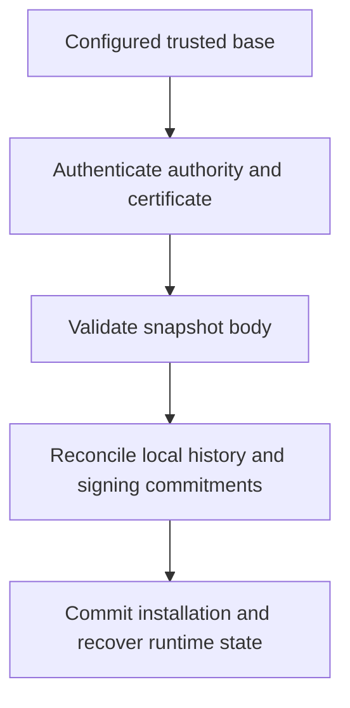

# Node operation and recovery

A node validates and stores ledger state, exchanges protocol data with peers and
serves the interfaces enabled in its configuration. Its ability to connect is
separate from its readiness to vote or serve authoritative state.

## Joining and synchronizing

Startup loads the selected network identity and recovers durable state before
admitting normal work. Configured peers provide connections and missing data;
received blocks and certified state still require validation.

A positive peer count does not prove the node has the current certified epoch,
required history or signing authority. Check synchronization and recovery status
before treating connectivity as readiness.

Blocks can arrive before their predecessor or source payment. The node retains
missing-dependency work in bounded queues and retries it when dependencies become
available. Queue capacity and retention limits protect local resources; queue
admission is not confirmation.

## Peer and database compatibility

Peers must match the selected network and the node's exact block and wire
protocol versions. A successful TCP connection alone does not satisfy these
handshake checks.

Database opening checks schema and layout markers, then commits supported index
rebuilds atomically. Unsupported layouts fail without deleting the ledger or
automatically starting a new one. Keep the original data when diagnosing a
compatibility error; follow the error's requirements for a separate fresh data
directory where needed.

## Reachability and services

An established outbound TCP connection carries traffic in both directions. A node
behind NAT can therefore communicate by dialing reachable peers without accepting
unsolicited inbound connections. Inbound reachability still depends on the router,
firewall and upstream network.

UPnP can request a router mapping when enabled. It does not guarantee reachability
through carrier-grade NAT or multiple routers. Operators can disable it with
`--disable-upnp`. Dev skips mapping. Setting `advertise_address` also skips it
and disables automatic address detection; use a numeric IPv4 address with an
optional `:port`. An invalid value is ignored without falling back to detection.

P2P, RPC and WebSocket have separate listeners. Prometheus metrics use `/metrics`
on the RPC listener when both RPC and metrics are enabled. Public peer connectivity
does not require exposing administrative RPC. RPC binds to localhost by default;
review authentication and bind settings before changing that boundary. External
time and randomness services have their own network behavior, described under
[privacy](../release/PRIVACY.md).

The metrics endpoint has incomplete instrumentation. `burst_votes_received_total`
has no updater, so zero does not mean no votes arrived. Block, account and
unchecked gauges are sampled at startup and shutdown. `burst_confirmation_latency_ms`
records election duration at durable confirmation handoff, not elapsed time from
network reception through cementation. `burst_transactions_received_total` counts
the node's transaction-submission API, not all blocks received over P2P or RPC.

## Peer traffic and duplicate handling

Blocks spread to randomly selected peers; authenticated votes also relay across
connections. Outgoing control and bulk traffic use separate bounded queues and
share per-socket and node-wide bandwidth budgets. Queueing does not guarantee
network delivery, and higher proof-of-work does not reorder outgoing messages.

Duplicate block gossip is briefly suppressed, then allowed to retry when missing
dependencies may have arrived. Repeated signature checks can use a cache, but
vote authority and routing still run. Requests and liveness messages are not
subject to blanket global deduplication.

The peer manager has a score-and-ban helper, but the running node does not invoke
its penalty method. Do not rely on automatic reputation bans as a deployed spam
control. Queue limits, bandwidth limits and validation are separate mechanisms.

## Queued blocks

The running node shares 65,536 retention slots across queued blocks, authentication
and dependency recovery. Blocks waiting for missing predecessors or sources can
occupy at most 61,440 unchecked entries, leaving 4,096 slots for ingress. Entries
older than 15 minutes are removed by a periodic sweep; the deadline is not an
instantaneous per-entry timer.

These counts limit retained entries, not total RAM. Blocks vary in size, and
indexes, workers, economic state and database mappings consume memory separately.
A bounded queue can reject work when full; it does not guarantee acceptance under
arbitrary load.

## Storage capacity

The default LMDB map limit is 1 GiB. To raise it, stop the node and set, for example:

```toml
database_map_size_bytes = 4294967296
```

This permits a 4 GiB database map on a host with a sufficient address space.
The value must be a positive whole number of MiB. Use the same configuration
for offline snapshot commands. The map limit is not a resident-memory limit
or a budget for recovery scratch space.

## Beacon relays

The default relay configuration is:

```toml
drand_relays = ["https://api.drand.sh"]
```

The client accepts one to four relays for the pinned chain. It requests the
same certified round from them in parallel and uses the first authenticated
response. A relay cannot select a different chain, round or verifier pool.
Remote URLs require HTTPS; numeric loopback HTTP is allowed for local tests.
Credentials, query strings, fragments, duplicates and redirects are rejected.
If no relay supplies a valid proof, the request remains pending.
See [randomness and selection](../protocol/CONSENSUS.md).

## Time and agreed transitions

BRN accrual, expiry, voting windows and beacon selection depend on time. Clock
synchronization supplies time estimates; it does not itself establish agreement
on a state transition. Certified boundaries coordinate deadline effects so that
one node crossing a local deadline cannot independently rewrite shared state.

The `get_telemetry` response reports `signing_clock` separately from the diagnostic
`ntp_offset_ms`. Its status is `ready`, `unavailable` (with a reason), or `disabled`.
A ready reading includes conservative `earliest` and `latest` Unix seconds;
it does not establish that this node is otherwise eligible to sign. A missing
field on an older response means unknown, not ready. The dashboard shows these
states separately. Logs report when authenticated signing time becomes available
or unavailable.

Configure `nts_sources` with three to eight independently operated NTS services.
Each entry has `operator`, `server_name` and `port` (normally 4460). These are local
operator choices, not consensus parameters; representatives need not use the same
providers. Repeated names or operator labels are rejected, but distinct labels
cannot prove independent infrastructure. Check reachability and actual ownership
before relying on a set of sources. An empty list disables fresh checkpoint
signing. Ordinary non-representative nodes do not start the NTS service.

Fresh samples already advance with monotonic elapsed time and increasing
uncertainty. They expire after 90 seconds; outages do not extend that limit or
permit an unauthenticated fallback. The operating system remains responsible for
its own clock. BURST does not set it.

Compact recovery rebuilds expiry caches at the authenticated checkpoint cutoff,
not an NTP-adjusted local timestamp. A current clock cannot rewrite the recovered
checkpoint's meaning.

## What restart must preserve

Recovery includes account frontiers, pending receipts, BRN history and stakes,
TRST holdings and provenance, verification and governance state. It also includes
installed authority and local signing commitments, such as final-vote promises,
checkpoint rounds and snapshot attestations.

Those commitments constrain what a signing identity may safely sign next. Do not
run independent copies of a signing identity from separate or stale databases.
A key backup alone does not restore that identity's durable signing history.

## Historical blocks from peers

Ascending bootstrap asks peers for account frontiers and subsequent block bodies.
A serving peer must still retain those bodies; knowing a hash does not reconstruct
the block. Responses are bounded to 128 blocks and the peer-message byte limit.
The receiving node checks chain continuity, applies normal admission, and advances
its cursor from persisted progress.

An empty response is not proof that no history exists. The serving path also
returns an empty batch after logging a storage error. Likewise, an idle bootstrap
queue does not prove that discovery found every account. Recovery that requires
missing history needs another retained source or the supported authenticated
snapshot path; it must not invent state from an unavailable predecessor.

## Authenticated snapshots

A snapshot can avoid replaying every old transaction, but its sender is not a
trust anchor. The archive reader authenticates authority transitions from the
configured base and checks the snapshot certificate before reading the economic
body. Body validation and installation checks remain separate steps.



A file checksum only checks file identity; it cannot replace authority and state
validation. Importing an authenticated archive is also not the same as installing
it. The startup path requires gated recovery, reconciles the snapshot with local
state and required history proofs, projects ledger and economic state, commits
and synchronizes storage before normal startup proceeds.

A peer download first uses temporary storage. Once the complete archive passes
its digest, authority, epoch and minimum-height checks, the node publishes the
requested output file without overwriting an existing destination. The installer
still has to reconcile local history and signing commitments before using it.
A peer's snapshot offer cannot change the configured trust base or freshness floor.

Archive handling has explicit size and resource budgets. Disk-backed processing
reduces the need to hold everything in memory; it does not remove those limits.
Snapshots do not contain private keys or replace local signer journals.

Operators create snapshots on demand for a named certified epoch. Each signer
reconstructs that epoch locally, then the exporter collects matching attestations.
There is no fixed daily or block-count export schedule.

Offline verification does not install the snapshot or establish that it is the
latest checkpoint. Use an independently obtained minimum checkpoint height or
expected epoch hash when freshness matters. The original genesis parameters must
also come from an independently trusted source.

## Pruning and retirement

Expiry alone does not make every historical record dispensable. Provenance,
restoration, authority authentication and signing continuity can still depend on
retained information. A compact recovery path must preserve what those operations
need, even when it no longer keeps every ordinary block body.

Physical body retirement is disabled by default, and current non-test startup
rejects enabling it. Do not bypass that qualification gate. Pruning also does not
promise bounded total storage as accounts and retained state grow.

## Backups

| Backup | What it preserves |
| --- | --- |
| Wallet recovery phrase | Cryptographic identity under BURST's derivation. |
| Encrypted keystore | Password-protected signing key. |
| Pending-action journal | Exact signed actions whose outcomes may be uncertain. |
| Node database and journals | Local ledger, recovery state and signing continuity. |
| Authenticated snapshot | Authorized shared state for a supported bootstrap or recovery path. |

Stop the owned node cleanly before taking a filesystem copy of its database.
Keep recovery material on a separate device or storage system; a copy on the
same disk does not protect against losing that disk. Restore with compatible
software and verify network identity and recovery status before resuming service.
See [build and upgrade checks](../release/DOWNLOADS.md).

## Implementation

- [Node lifecycle](https://github.com/BURST-UBI/protocol/blob/main/node/src/node.rs)
- [Configuration](https://github.com/BURST-UBI/protocol/blob/main/node/src/config.rs)
- [Drand relay validation](https://github.com/BURST-UBI/protocol/blob/main/vrf/src/drand.rs)
- [Missing-dependency queue](https://github.com/BURST-UBI/protocol/blob/main/node/src/unchecked.rs)
- [Snapshot archive reader](https://github.com/BURST-UBI/protocol/blob/main/node/src/confirmed_replay/snapshot/archive.rs)
- [Startup snapshot installation](https://github.com/BURST-UBI/protocol/blob/main/node/src/node/snapshot_bootstrap.rs)
- [Installation journal checks](https://github.com/BURST-UBI/protocol/blob/main/node/src/confirmed_replay/snapshot/installed/journals.rs)

## Logging

Set `RUST_LOG` before starting the daemon to control tracing filters. If absent,
the initializer uses `BURST_LOG_LEVEL`, then defaults to `info`. Output is
human-readable text. Initialization precedes CLI and file configuration parsing,
so stored `log_level`, `log_format`, and explicit `--log-level` arguments do not
reconfigure the subscriber.
