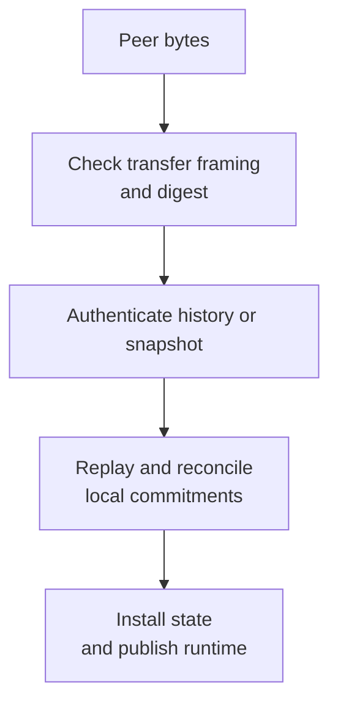

# Checkpoints and state transitions

A checkpoint agrees on a ledger cut and the shared state derived from it.
It connects account-chain history to verifier selection, identity outcomes,
governance decisions and changes in representative authority.

A certificate, a replayed candidate and installed state are different things.
A certificate authenticates agreement. Replay checks the agreed history and its
consequences. Installation commits those consequences and coordinates the running
node before it accepts work under the new state.

## Authority and replay

The previous trusted roster authenticates the next checkpoint. Each verified
human contributes one unit to their representative. The installed quorum is an
integer threshold rounded upward; local online estimates cannot shrink it.
A new roster cannot authenticate itself simply by supplying its own signatures.

Certificate signatures bind the precommit phase, round and checkpoint hash.
The checkpoint commits its network and genesis, parent, height, cutoff, ledger,
parameters, next roster and quorum, and event commitment. Signatures from different
rounds cannot be combined into one decision. Duplicate or unknown signers and
invalid signatures are rejected.

Signature checks alone do not establish that the proposed state is valid or
that its history is available. Replay reconstructs the cut from authenticated
history, checks causal dependencies and derives the event and successor roster.
Missing dependencies are not permission to use a peer's claimed balances.

The same agreement machinery supports different events:

| Event | What it establishes |
| --- | --- |
| Selection | A frozen request, eligible pool and exact future beacon round. |
| Panel activation or deadline | Agreed timing and completion of the named panel. |
| Identity outcome | Settlement and any resulting verification, revocation or restoration effects. |
| Governance boundary | Counted results or scheduled changes under the applicable rules. |
| Roster update | A changed representative electorate without inventing a verifier selection. |

These events have distinct commitments and replay rules. An identity outcome or
roster-only update does not require a new random committee merely because it is
a checkpoint.

## How a checkpoint round works

The proposer rotates through the human-sorted roster using the next height and
round number. A representative has one proposer slot per human delegated to it.
The proposer suggests a checkpoint; it cannot approve that checkpoint alone
unless its delegated weight reaches the required quorum.

| Step | What happens |
| --- | --- |
| Propose | The designated representative proposes a fresh valid cut or reuses a prepared value with its proof. |
| Prevote | Representatives check the proposal and their locks, then vote for its hash or for no value. |
| Precommit | A quorum of prevotes for the same hash lets a representative lock that value and precommit it. |
| Decide | A quorum of precommits for one hash in one round forms the checkpoint certificate. |

A proposal timeout can produce a prevote for no value. Prevote and precommit
timeouts also require quorum evidence that representatives reached that phase;
their votes need not agree on a value. A later round can be entered with
participation exceeding the tolerated fault weight, but this does not certify
any checkpoint. Locks and prepared evidence survive round changes.

The round machine does not run a clock, write its own journal or execute the
ledger. The node supplies timer events, validates the proposed state and persists
choices before signing. A learned decision certificate can come from another
round; installation remains a separate step.

## Signing time and randomness

Selection freezes the target, triggering operation, attempt, eligible pool,
committee size, parameters, cutoff and beacon round. The round is the first
approved beacon round strictly after the cutoff. A committee cannot be selected
from whichever accounts or latest beacon happen to be visible locally.

Before fresh selection signing, the node checks that its conservative time bound
is still before beacon release. A certificate is not a cryptographic timestamp.
This protection depends on honest signers enforcing the timing rule and on the
beacon's unpredictability assumptions.

The signing clock uses authenticated NTS observations, separately from diagnostic
SNTP offsets. At least three configured sources must supply fresh observations;
the model tolerates at most one incorrect source. Authentication does not prove
independent operators or accurate physical clocks. The bounds also assume that
honest sources cover their UTC error and that local monotonic drift stays within
the modeled allowance.

Observations older than 90 seconds are unusable. Wall/monotonic divergence above
250 milliseconds, excessive uncertainty or too few fresh sources makes signing
time unavailable. Bounds continue to age during replay and storage work.
The client does not reset the host clock or fall back to an unauthenticated
zero-error estimate. Operators can inspect `get_telemetry.signing_clock` and
clock-availability transition logs; a diagnostic NTP offset is not signing readiness. Bad host time can also prevent TLS authentication.

The NTS client rejects duplicate hostnames and declared operator labels, but
configuration cannot establish independent ownership. Choose sources with
independent administration. Each worker limits key exchange to ten seconds and
a query to five seconds, then waits at least 64 seconds before another attempt.
A failed query preserves the last accepted observation only until it becomes
stale; it does not renew that observation's authority.

Once a request is certified, relay retries must fetch that exact round from the
pinned chain and verify its BLS proof. A relay outage cannot justify a new pool
or a different random round. See [relay configuration](../node/NODES.md#beacon-relays)
and [verifier eligibility](VERIFICATION.md).

## Durable signing and recovery

The round machine retains proposal, prevote, precommit, lock and prepare evidence.
A timeout does not erase a lock. Later proposals must satisfy the round machine's
rules for prepared evidence; elapsed time alone cannot authorize resampling an
already prepared selection.

The node persists signing transitions and their replay manifests before returning
signatures. Restart recovery validates retained manifests against the certified
parent and required history. Missing inputs stop recovery rather than replacing
saved commitments with a fresh choice.

One representative key needs one durable signing history. Independent databases
for copies of that key do not coordinate their reservations. Restoring an old
signer database can also lose promises that other nodes already observed.
Keep signing journals with the recovery state; a key backup is insufficient.

Expired, unprepared proposals and prepared values have different recovery rules.
Fresh proposals at later cuts still need replay and pre-beacon checks. Delayed
prepare evidence retains its original value. The
[deadline recovery specification](https://github.com/BURST-UBI/protocol/blob/main/spec/design/DEADLINE_RECOVERY.md)
records the detailed policy and adversarial questions; a controlled-clock test
alone cannot prove resistance to every scheduling or selection-bias attack.

## Payment-epoch handoff

Ordinary signed blocks name their payment epoch. A later identity or authority
change must not reinterpret an old payment signature under new rules.
Representatives retain epoch-scoped final-vote commitments, and checkpoint
signing checks the candidate against the signer's applicable promises.

An unresolved final reservation outside a cut can prevent that signer from
approving it. An observer may still learn an authenticated quorum certificate
that excludes its local minority promise. Installation preserves that promise
and closes the old epoch; it does not discard network-final history or reopen
old signing authority. Conflicting reservations can prevent progress.

In the certified path, payments use the installed electorate. Local confirmation
cannot independently replace it. Installing a successor retires the old elections
and candidate routes before payments resume under the new epoch.

## Installation

The durable installer checks the parent and exact certified record, reconciles
local history and signing commitments, and projects the replayed economic and
authority state in a storage transaction. It checks cemented positions and
pending confirmation handoffs before replacement. A convenient local head list
is not enough evidence to overwrite confirmed history.

A forced synchronization precedes publication of rebuilt engines. The runtime
coordinates installation between block admissions and fork replacement, replaces
its caches and elections, and resumes using the installed state. Calling a storage
helper alone does not complete that live transition.

The node has full-history, compact and snapshot installation paths. Compact
recovery must still authenticate authority and preserve required history and
signing continuity. It is not permission to delete every expired block.
See [snapshots and retirement](../node/NODES.md#authenticated-snapshots).

Committee installation also checks the request's lifecycle identity. Initial
verification, revotes and successive challenges cannot borrow one another's
stakes or context. Vote and stake receipts retain their certified attempt;
changes in current parameters cannot silently rewrite a stake already locked.
See [verification and challenges](VERIFICATION.md) and
[governance ordering](GOVERNANCE.md).

## History transfer

History recovery separates three checks:

| Check | What it establishes |
| --- | --- |
| Transfer digest | The assembled bytes match the advertised digest. |
| Authenticated history cursor | A block belongs to the account prefix committed by a trusted snapshot or checkpoint. |
| Semantic replay | The history obeys the protocol and produces the claimed state. |

A peer's account hint only tells the receiver where to look. The receiver follows
hashes from an independently authenticated account head before accepting the
history. Cached bodies need the same context checks. Membership alone does not
establish valid economic effects.

Transfers use bounded chunks, queues and reassembly. Snapshot archives have a
local byte budget separate from the smaller checkpoint-record and witness limits.
The receiver authenticates the archive and checks its expected epoch and minimum
height before publishing the downloaded file. Publication does not install state.

During startup recovery, ordinary block and vote traffic remains closed.
Authenticated peer connections can carry the recovery messages needed to finish
startup. Snapshot and proposal-content traffic also require their registered
recovery services. Ordinary traffic resumes after runtime publication.

An authenticated history exception applies only to the covered blocks. It does
not disable signatures, work checks, dependencies or economic validation for
arbitrary old blocks. Receiving a certificate does not itself install its
accounts, balances or committee. See [node recovery](../node/NODES.md#authenticated-snapshots)
and the [wire-format reference](https://github.com/BURST-UBI/protocol/blob/main/messages/WIRE.md).

## Qualification requirements

The certified paths remain subject to their network and release gates. These
requirements describe what evidence must cover, not a list of currently missing
implementations or a claim that all scenarios have passed:

1. Replay complete causal history, including identity, penalties, delegation and
   governance effects, and derive the same authority on independent nodes.
2. Authenticate proposal agreement, bounded transfer, persisted certificates and
   catch-up from the configured trust base. Peer-supplied authority is insufficient.
3. Exercise pre-beacon timing and missed-deadline recovery under adversarial
   scheduling, including delayed prepare evidence, outages and partitions.
4. Commit admission, frozen inputs, lifecycle settlement and installation without
   partial state, and resume exact-round requests after interruption.
5. Preserve stake receipts, complete panel dependencies, payment fences and
   irreversible bootstrap exit across fork handling, outcomes and recovery.
6. Test independent arrival orders, missing dependencies, conflicting proposals,
   mid-transition crashes and fresh-node recovery through the real wire path.

Use the [validation workflow](https://github.com/BURST-UBI/protocol/blob/main/spec/VALIDATION_WORKFLOW.md)
to match evidence to changed inputs and requirements. A component pass, imported
certificate or successful genesis verification does not establish an end-to-end
certified lifecycle. Consult [build qualification](../release/DOWNLOADS.md) for the
separate release boundary.

## Implementation

- [Certificates and roster authority](https://github.com/BURST-UBI/protocol/blob/main/consensus/src/checkpoint.rs)
- [Consensus rounds](https://github.com/BURST-UBI/protocol/blob/main/consensus/src/checkpoint_round.rs)
- [Durable signing](https://github.com/BURST-UBI/protocol/blob/main/node/src/checkpoints/agreement.rs)
- [Frozen selection requests](https://github.com/BURST-UBI/protocol/blob/main/verification/src/selection_request.rs)
- [Signing time bounds](https://github.com/BURST-UBI/protocol/blob/main/network/src/trusted_clock.rs)
- [Durable installation](https://github.com/BURST-UBI/protocol/blob/main/node/src/confirmed_replay/installation.rs)
- [Runtime installation](https://github.com/BURST-UBI/protocol/blob/main/node/src/checkpoints/installation.rs)
- [History synchronization](https://github.com/BURST-UBI/protocol/blob/main/node/src/checkpoints/sync.rs)
