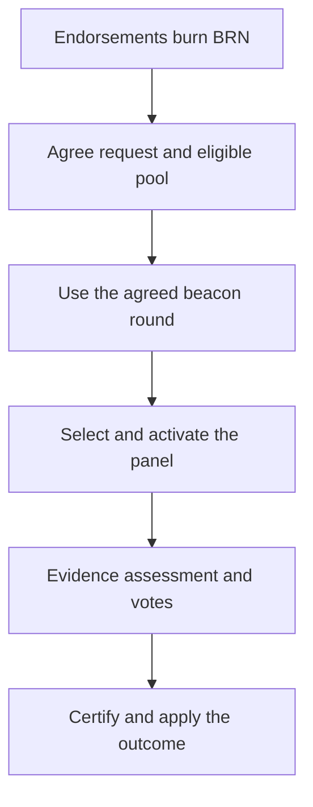

# Verification, challenges and restoration

Verification determines which accounts qualify for BRN accrual and human-based
voting rights. It records endorsements, selected-panel votes and agreed outcomes.
It does not cryptographically prove that a person is unique or that their evidence
is truthful.

## Network availability

The current global certified-selection switch is off. The `experimental-testnet`
feature can enable it on Test and Dev, never Live. Appeals have a separate gate
with the same network restriction. A function's presence in the library does not
make it an available production operation.

The rules below describe those implemented paths. Bootstrap has separate
[creator-authority rules](BOOTSTRAP.md).

## Ordinary enrollment

Endorsers permanently burn BRN. They do not receive a protocol reward when the
applicant succeeds, and a failed application does not refund that burn.

Selection uses agreed ledger state rather than whichever accounts a node happens
to know. The replay eligibility check requires verified status, an on-chain
verifier opt-in, sufficient verified age, the minimum BRN balance and completed
external TRST activity with a counterparty that is still verified. Opt-in alone
is not enough. Panel selection also applies its request-specific exclusions.

The request commits to the eligible pool before its designated drand beacon is
available. After verifying the checkpoint certificate and that exact beacon
round, nodes rank pool members by a hash of the beacon value and wallet address.
The lowest-ranked members form the panel. Later eligibility changes do not
rewrite the frozen pool. A certificate relies on its signers checking the pool
and signing deadline; the signatures alone cannot prove when they were made.

With a seven-member panel and a 90% Legitimate threshold, all seven must vote
Legitimate: six of seven is only about 85.7%.

The vote stake is separate from the minimum selection balance. Current defaults
and durations are listed in [protocol parameters](PARAMETERS.md).

## Votes and settlement

| Vote | Stake | Effect on acceptance |
| --- | --- | --- |
| Legitimate | Required | Supports acceptance. |
| Illegitimate | Required | Does not support acceptance. |
| Neither | None | Does not support acceptance; remains in the tally denominator. |

Absent votes become Neither at the applicable deadline. Repeated Neither votes
can trigger selection exclusion under a rolling assignment window. Neither is
therefore distinct from both a substantive Illegitimate judgment and an ignored
assignment.

By default the window retains up to 100 assignments and the penalty triggers
strictly above 50% Neither. There is no minimum sample size: one Neither on a
first assignment already exceeds that threshold. Applying a penalty clears the
history immediately and starts the selection cooldown, seven days by default.
The window counts assignments rather than days.

If the required Legitimate share is not reached, the configured re-vote limit
controls further attempts. Deadline settlement belongs to agreed protocol state;
a node's local clock alone cannot independently decide a panel outcome.

The activation fixes the deadline using the parameters at activation. Missing
members receive synthetic zero-stake Neither votes, so absence does not reduce
the completed panel's denominator. Those records are distinct from signed votes.
A revote excludes the preceding panel and requires a new selection; prior votes
remain available for stake settlement.

Staked voters who agree with the settled outcome recover their stakes. Rewards
share forfeited dissenting stakes equally among those winning staked voters,
using integer division. With no forfeited stakes there is no such reward pool.
“Winning” means agreement with the settled judgment, not proof of factual truth.

A successful verification establishes the recorded eligibility time for BRN.
Balances are still subject to burns, locked stakes and release acknowledgment.

## Challenges

A challenge names a target, supplies the required stake and goes through the
applicable admission, panel and outcome rules. Submission itself does not revoke
an account.

An upheld fraud challenge removes verified rights and revokes TRST derived from
the target's origins, including affected contributions through merges. An upheld
inactivity challenge deactivates the account without revoking past TRST. These
are different economic consequences, not interchangeable labels.

A rejected challenge can forfeit the challenger's stake. A successful fraud
outcome can pay a capped reward based on revoked TRST. Costs and rewards do not
prove that collusion or harassment is unprofitable.

## Re-verification and appeals

Verified status has no calendar-based renewal deadline. Voting deadlines and
verifier penalty cooldowns do not impose periodic enrollment on every account.
An unresolved challenge retains verified rights until its outcome is applied.

An unverified or deactivated verification state can restart with a new
endorsement once any active challenge settles. The endorsement must not predate
the prior outcome. Restart clears the old panel, votes and attempts; ordinary
enrollment must meet its requirements again. Successful re-verification resumes
retained BRN history without accrual for the inactive interval.

Re-verification asks whether the account should regain eligibility. When the
commit path verifies a previously revoked account, it restores that originator's
affected holdings and pending contributions, then updates account state. It does
not mint replacement copies. Restored amounts remain subject to expiry.

An appeal instead names an earlier challenge judgment. Settlement compares the
new judgment with that recorded judgment; it is not an ordinary challenge payout
applied again. This path is currently unavailable on Live. Do not promise users a
production appeal service based on its experimental implementation.

The wallet appeal API refetches the node's review immediately before submission.
It requires the outcome and required stake to match what the user reviewed, rejects
an active challenge, and checks that appeals remain enabled. A changed review must
be loaded again. These checks use the node's report; parsing a nonzero checkpoint
reference is not independent verification of its certificate.

Neither restoration nor an appeal can reverse goods or services exchanged outside
the ledger. Recipients can bear the consequences of a wrong or fraudulent origin
judgment even when they acted honestly.

## Evidence and privacy

Evidence assessment happens outside vote counting. The `VerificationMethod` trait
is an interface, not a shipped identity-document or biometric verification
service. Communities must decide how evidence is collected and assessed without
assuming that the protocol supplies those integrations.

Verification evidence may expose personal information. A public account address
and its ledger history should not be mistaken for an anonymous identity. See
[privacy and network behavior](../release/PRIVACY.md).

## Implementation

- [Selection gate](https://github.com/BURST-UBI/protocol/blob/main/verification/src/lib.rs)
- [Replay eligibility](https://github.com/BURST-UBI/protocol/blob/main/node/src/confirmed_replay.rs)
- [Voting and timeout defaults](https://github.com/BURST-UBI/protocol/blob/main/verification/src/voting.rs)
- [Stake and reward outcomes](https://github.com/BURST-UBI/protocol/blob/main/verification/src/outcomes.rs)
- [Challenge transitions](https://github.com/BURST-UBI/protocol/blob/main/verification/src/orchestrator.rs)
- [Verification and restoration commit](https://github.com/BURST-UBI/protocol/blob/main/node/src/verification_commit.rs)
- [Appeal release policy](https://github.com/BURST-UBI/protocol/blob/main/node/src/release_policy.rs)

## Endorsement limits and revocation

The current node has no per-endorser limit on simultaneous applications across
different targets. It rejects duplicate endorsements within an attempt and
requires the ordinary endorsement burn. Endorsements disclose the endorser and
target on the ledger.

Revoking an endorser does not currently remove its endorsements from other pending
applications. A standalone removal helper exists, but the node revocation path
does not invoke it. Automatic invalidation and a cross-target active-endorsement
cap were intended rules that remain unimplemented. Neither should be assumed
when assessing the current verification system.

## Evidence and notifications

The challenge transaction has no evidence attachment or URL field. Applications
must arrange evidence sharing separately. Its signature and stake authorize a
request; neither proves fraud or inactivity.

The WebSocket library exposes a verification topic, but the node does not
currently publish challenge outcomes through its publisher. Clients must query
current verification state rather than rely on a push notification. Generic
WebSocket broadcasts can lose events when a subscriber falls behind.
