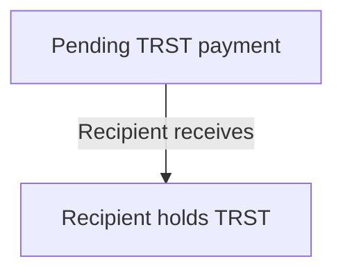
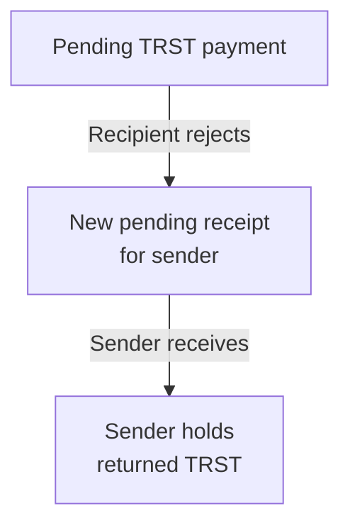
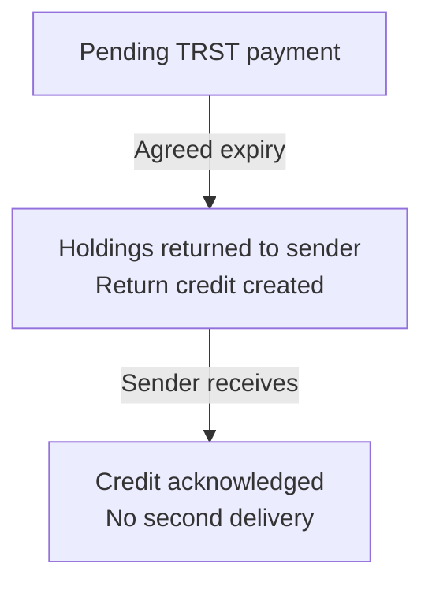

# Sending and receiving

A payment takes two signed operations: one from the sender and one from the
recipient. The sender either burns BRN to create TRST or sends TRST they already
hold. Once accepted by the node, the payment is **pending**: it has left the
sender but the recipient has not yet received it. The stored pending entry is
called a **pending receipt**.

The recipient signs a receive operation to claim it. For a new account, that claim
can also open its account chain. The node checks the receipt, amount, provenance
and account predecessor, and consumes the pending entry once.

An account can also open empty, with zero TRST and zero recorded BRN spending.
Verification may precede its first signed block; opening the chain preserves that
identity state. Neither an empty Open nor a receive grants verification by itself.

For example, burning 5 BRN creates a pending receipt for 5 TRST; it does not
increase the recipient's BRN allowance. Sending 2 of those 5 TRST later leaves 3
with the sender and 2 pending for the next recipient, without new issuance.

An unverified account can receive TRST. Receipt does not grant BRN accrual or the
verified rights required for ordinary spending. The ledger also cannot establish
whether goods or services were delivered in exchange for a payment.

## Acceptance, rejection and expiry

**Accept the payment**

**Reject the payment**

**Let the payment expire**

The arrows describe accepted ledger transitions, not merely signed or submitted
requests. Rejection and expiry return value through different paths:

| Event | Result |
| --- | --- |
| Recipient accepts | A signed receive consumes the pending entry and delivers its holdings. |
| Recipient rejects | A signed `RejectReceive` creates a new pending entry for the sender, keyed by the rejection block. The sender claims it explicitly. |
| Recipient does nothing | The receipt remains pending, subject to expiry and other protocol rules. |
| Pending TRST expires | The agreed expiry transition delivers it back to the sender and creates a return credit for acknowledgment. |

Rejection does not delete the original send or reverse a BRN burn. It returns
TRST through another pending receipt. Neither account's signed balance is silently
rewritten by the other's rejection.

Expiry returns work differently: the transition has already delivered the
holdings. The sender's later receive acknowledges the return credit without
delivering them a second time. It does not renew their age. The return goes to the
sender of the pending payment, who may differ from the original BRN burner.

## There is no arbitrary refund timer

A sender cannot treat silence as permission to spend the value again. Expiry is
based on the holding's effective origin time and the governed expiry period,
not an arbitrary interval after sending.

In the certified replay path, agreed deadline effects follow replay of signed
blocks from the old epoch. The certificate closes that epoch against late
claims. A receive that has already consumed a receipt and an expiry return cannot
both credit the same payment.

Pending delivery validates provenance. An expired receipt cannot be accepted as
an ordinary live payment, and revocation can affect the value carried by a
receipt. These checks also run against the durable write state to detect changes
between preparation and commit.

## Wallet responsibilities

Display whether the action is a burn, an existing-TRST send, a receive or a
rejection. Keep the exact signed action until its outcome is resolved. An RPC
submission result is not the same as confirmation; a lost response is not proof
that no payment happened. See [offline signing and reconciliation](WALLETS.md#offline-actions).

The wallet's transfer-selection helper requires one origin to cover the entire
amount, though several active holdings from that origin can contribute. Without
an explicit origin, it selects the first sufficient origin in sorted string order,
not the holding nearest expiry. A balance spread across different origins may
therefore need a smaller payment or an explicit compatible merge first.

For amounts, ageing and merge behavior, see [BRN and TRST](../introduction/ECONOMICS.md).

## Implementation

- [Economic admission and delivery](https://github.com/BURST-UBI/protocol/blob/main/node/src/economic_candidate.rs)
- [Pending claim and rejection commit](https://github.com/BURST-UBI/protocol/blob/main/node/src/ledger_updater.rs)
- [Pending provenance and delivery](https://github.com/BURST-UBI/protocol/blob/main/node/src/block_economics.rs)
- [Certified expiry transition](https://github.com/BURST-UBI/protocol/blob/main/node/src/confirmed_replay/deadline.rs)
- [Durable expiry effects](https://github.com/BURST-UBI/protocol/blob/main/node/src/expiry_commit.rs)
