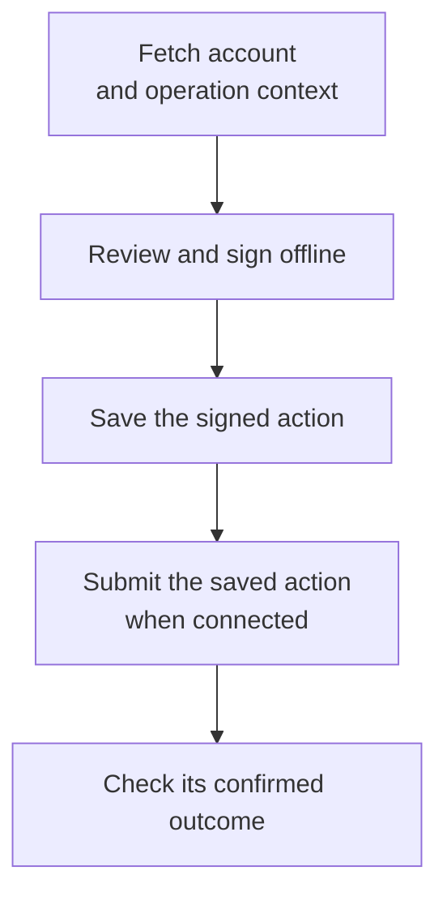

# Keys and signing

Your wallet keeps the key that authorizes actions on your account. When you pay
someone, it signs the action locally and sends it to a node for checking. The
node can verify the signature without receiving your private key.

This division explains recovery: restoring the key gives you control of the
same account, but it does not recreate the account's history on your computer.
The wallet reads balances and verification status from the network and must
also resolve any previously signed payment whose outcome is still uncertain.

## Recovery phrase and local password

The recovery phrase lets you recreate your account's signing key. The local
password has a different job: it protects the saved key file on this device.
Someone with the phrase does not need that password, which is why the phrase
needs its own private backup.

For developers, the phrase uses BIP39: 24 words generated from 256 random bits.
Those bytes are the wallet seed. BURST derives account zero with
BLAKE2b-256(seed || four-byte big-endian index), matching Nano’s account-key
construction. It retains BURST signature and address formats. Importing the phrase
into another wallet is not guaranteed to produce the same address.

The local keystore encrypts the 32-byte secret key with AES-256-GCM. Version 1
uses Argon2id with 64 MiB of memory, three iterations and one lane to derive the
encryption key from the password. Each encryption uses a random salt and nonce.
The loader rejects unsupported cipher, KDF and version-1 parameter profiles.

The password protects the encrypted file. The recovery phrase independently
recreates the signing key; it is not protected by that file's password. Preserve
recovery material privately and check the restored public address before use.

The exact seed derivation and address encoding are described in
[cryptographic formats](../development/CRYPTOGRAPHY.md).

## What a phrase does not restore

| State | Restored by the phrase? |
| --- | --- |
| Cryptographic account identity | Yes, using the same BURST derivation. |
| Current balances and eligibility | Retrieved from the network. |
| Saved signed actions awaiting resolution | No; these are local journal records. |
| Device signing binding | No; the wallet must establish the appropriate signing role. |
| Representative signing history or node database | No; these require their own durable state and recovery. |

A local wallet object may initially report an unverified state until it reads the
network. That initialization does not revoke an existing on-chain identity.

## Desktop automation

Automatic acceptance defaults to on, with no sender allow-list. While the wallet
is unlocked, each maintenance call checks up to eight pending payments. A sender
allow-list or group policy can hold payments for review; holding is not a signed
rejection or return. Automation shares the signing lock with manual actions and
checks that the wallet and automation session have not changed.

The desktop merge slider defaults to 50 on a 0–100 scale. Zero disables automatic
merging. Other values bound the permitted loss of remaining lifetime relative to
the longer-lived input; the merged output takes the earliest expiry. At 100,
eligible inputs can be grouped regardless of lifetime difference, subject to the
input bound. Maintenance submits at most one suggested group per call and still
requires spending eligibility. The shared helper's default of 10 is separate
from the desktop setting.

The Activity page fetches account history from the node in pages of 25. Local
signed-action journals and receipts track submission recovery, not a complete
copy of the account's historical ledger.

## Display conventions

The desktop normally displays six decimals, while the ledger retains 18-decimal
raw units. Formatting truncates; a positive value below display precision gets a
less-than indicator. Keep raw amounts as integer strings when exchanging JSON.

The Receive QR contains only the account address. The desktop has no implemented
`burst:` payment-link handler, persistent nickname/address book or on-chain name
registry. Its trusted-sender list controls automatic acceptance, not contacts.

Portfolio badges distinguish active, expiring, expired and revoked holdings. The
warning threshold is less than 30 days remaining, not a percentage of lifetime.
The linear pricing reference is informational and does not alter token amounts
or determine a market price.

## Balance displays and local estimates

The wallet's single-rate and rate-history estimates assume uninterrupted accrual.
They cannot account for a pause they were not given. `compute_balance_from_state`
includes the supplied pause history and locked stakes, but returns **available**
BRN before subtracting returned stakes awaiting acknowledgment. The engine's
`spendable_balance_checked` applies that final deduction.

For example, 100 available BRN with 20 awaiting release acknowledgment permits
80 BRN of spending. A display helper or a locally reconstructed estimate does not
authorize a payment; the node checks the submitted operation against current state.

The `Wallet` estimate methods use cached timestamps and deductions. They do not
check the cached verification-state enum, so a deactivated account with a retained
verification timestamp can still produce a positive estimate. Refreshing from a
node updates those cached fields; it does not add pause history to these methods.
Changing the configured node does not refresh them automatically.
See [BRN accounting](../introduction/ECONOMICS.md#brn-balance).

## One account chain, multiple devices

Two devices cannot independently spend the same account frontier. Blocks include
a signing grant, and the supported wallet workflow keeps a local binding to it.
A signing-device change is an explicit signed operation. The wallet publishes its
local binding after confirming the handoff.

A missing binding means an unenrolled profile; it does not establish ownership of
the current network grant. Corrupt or mismatched bindings are errors. These rules
coordinate normal wallet use; they do not neutralize someone who possesses the
root signing key.

## Building and signing operations

Use `burst-wallet-core` for block construction and signing. The normal sequence is:

1. Read the account head and current protocol context from the node.
2. Select the operation inputs, such as spendable holdings or a pending receipt.
3. Build the block, generate its work, and sign it locally.
4. Save the exact signed action before submitting it through `process`.
5. Check confirmation before reporting the payment as complete.

The client has separate signed helpers for paying with BRN (`pay_signed`),
transferring TRST (`transfer_signed`) and claiming a receipt (`receive_signed`).
A custom integration must also manage the signing-device binding and unfinished
actions described below. Calling a signed helper alone is not a replacement for
that state management. See [RPC](../development/RPC.md) for transport examples.

Low-level transaction builders create unsigned drafts. The block builder combines
one with a supplied account snapshot, checks balance arithmetic and some required
fields, then computes a block hash. It does not fetch current state or establish
that the operation is eligible for acceptance.

`sign_state_block` signs the stored hash. If a caller edits hashed fields, it must
recompute that hash before signing. The helper does not check that the key controls
the account. Signing, supplying proof of work, submitting and confirming are
separate steps; a signature alone does not prove that a payment succeeded.

## Offline actions

Offline signing separates preparation, signing and submission:

Preparation obtains the frontier, parameters, epoch, signing grant, proof of work
and operation-specific inputs. Those inputs can include holdings, a pending
receipt or voting context. The offline signer uses the prepared data without
confirming anything on the network.

Prepared context contains node-supplied public state, not an independent proof of
balance or authority. It can become stale if the account advances, an epoch or
grant changes, a voting window closes, or a holding expires or is revoked. The
node still applies the normal rules at submission.

Saved ancestry is a bounded account-chain segment. Its hashes and signatures are
checked, but it may be empty or stop before the opening block. It is recovery
context, not a confirmation certificate. Similarly, loading a local device binding
checks the saved handoff; the application must check its current network status.

## A lost response is not a failed payment

Suppose the node accepts a signed payment but its reply never reaches the wallet.
Signing a new payment immediately could create a conflict or a later duplicate
payment. Retry by submitting the saved signed action, not by rebuilding it with a
new hash.

The native journal saves immutable signed actions before submission when the
client is configured with a journal path. Records include the signed block and
required recovery context, not the private key. Applications must store them in a
private data directory because payment details remain sensitive.

The desktop wallet resolves an uncertain action using its original hash and
account position:

| Result | Meaning |
| --- | --- |
| Confirmed | The exact saved action is confirmed. |
| Superseded | A different confirmed successor occupies its account position. |
| Excluded | The epoch-exclusion check proves the saved action cannot be accepted. |
| Unresolved | Keep the draft; available evidence does not establish one of those outcomes. |

A missing RPC result or a node reporting “not found” is not sufficient exclusion
proof. The node might be behind. Restoring the phrase on another device does not
remove this uncertainty.

## Preparation can advance the account

Before a requested operation, the signing client may submit stake-release
acknowledgments in batches. These keep the representative unchanged but advance
the account chain. The final release batch can accompany the requested action.

`WalletError::Preparation` means the requested action was not submitted. It does
not mean that preparation made no network changes. Check any saved acknowledgment
before retrying; it may have been submitted even if its response was lost.

## Completed receipts

After resolving an action, the native journal archives its signed draft before
removing the active file. The outcome label is supplied by the caller; writing a
“confirmed” receipt does not itself establish confirmation.

Cleanup normally keeps 100 completed receipts per account, preserving the newly
archived receipt and choosing the others by file modification time. It leaves
legacy flat receipts untouched. Cleanup errors are reported without turning a
resolved action back into a failed payment, so the directory can temporarily exceed
that limit. These local receipts are not a permanent transaction-history backup.

## RPC integration

The low-level `NodeClient` methods parse RPC responses. `process` does not journal
an action or wait for confirmation, and `work_generate` does not itself verify the
returned work. Use the signing and recovery workflows when submitting wallet
operations, rather than treating these transport methods as complete workflows.

Balance responses carry amounts as decimal strings. Preserve those strings or
parse them into an integer type that supports the protocol's range; JavaScript
`Number` cannot represent every amount exactly. Pending-receipt responses may
include a cursor, and `account_pending` does not fetch subsequent pages for you.

## Payment acceptance policies

The desktop can check the immediate sender, the original BRN creators, or group
membership before automatically receiving a payment. These are optional wallet
policies, separate from protocol validation. See [acceptance policies](TRUST.md)
for the choices and outage behavior.

## Guardians and shared custody

`CustodianshipRegistry` records guardian relationships in memory. Its caller must
establish consent and authorization. The registry itself neither verifies a
signature nor grants spending authority, and it is not a complete guardian
recovery service.

Actual control still depends on signing keys and the supported device-handoff
rules. A guardian relationship does not create an extra eligible identity for the
guardian.

## Implementation

- [Mnemonic derivation](https://github.com/BURST-UBI/protocol/blob/main/crypto/src/mnemonic.rs)
- [Wallet construction and restoration](https://github.com/BURST-UBI/protocol/blob/main/wallet_core/src/wallet.rs)
- [Encrypted keystore](https://github.com/BURST-UBI/protocol/blob/main/wallet_core/src/keystore.rs)
- [Signing-device binding](https://github.com/BURST-UBI/protocol/blob/main/wallet_core/src/signing_device.rs)
- [Offline contexts](https://github.com/BURST-UBI/protocol/blob/main/wallet_core/src/offline.rs)
- [Durable action storage](https://github.com/BURST-UBI/protocol/blob/main/wallet_core/src/offline/storage.rs)
- [Desktop reconciliation](https://github.com/BURST-UBI/wallet/blob/main/src-tauri/src/offline.rs)
- [Guardian registry](https://github.com/BURST-UBI/protocol/blob/main/wallet_core/src/custodianship.rs)
